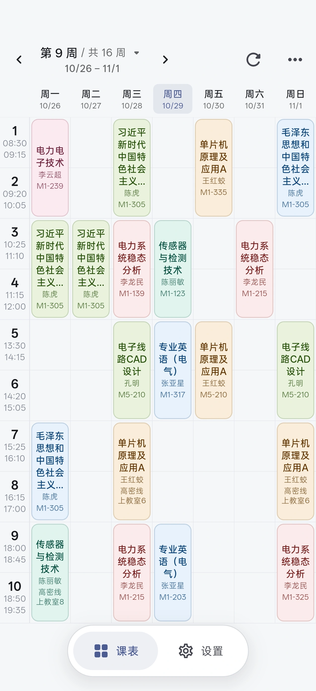
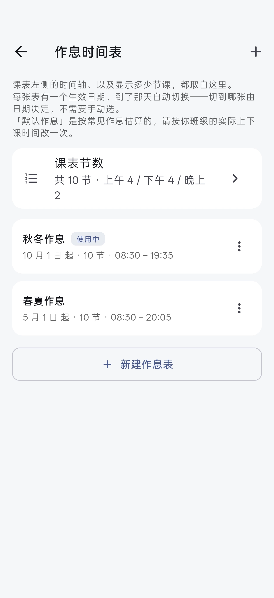

<div align="center">


# 青科课表通

<a href="https://github.com/fangzi2006/QustSchedule/releases"></a>


**[下载 APK / Windows 客户端](https://github.com/fangzi2006/QustSchedule/releases/latest) · [界面预览](#界面预览) · [功能特性](#功能特性) · [快速开始](#快速开始)**

✨ **专为青科大学生打造的现代化轻量课表工具 · 移动端与桌面端双平台支持** ✨

</div>

## 界面预览

<table>
  <tr>
    <th>周视图课表</th>
    <th>多套作息表</th>
  </tr>
  <tr>
    <td></td>
    <td></td>
  </tr>
</table>

## 功能特性

### 📅 课表展示与管理

- **登录一次，长期免登**：学号密码仅保存在系统硬件级安全存储中（Android Keystore / Windows DPAPI）。会话失效时自动用保存凭据静默重登；具备连续失败熔断机制，防止频繁重试锁死教务账号。
- **周视图浏览与快速回正**：支持按周翻页，不在本周时右下角自动浮出「今」按钮，一键回到当前周；点击课程卡片可弹窗查看教室、教师、周次等完整详情。
- **自定义外观**：课表格子高度、课程卡片文字字号均可自由缩放调整。
- **实践课程与备注区**：课表下方独立展示教务系统中的「实践环节 / 其他课程」备注区，支持一键切换显示或隐藏。
- **同日冲突智能提示**：当因调课或选课出现同时间段多门课程时，表头日期自动标识冲突，卡片层叠显示并支持点击查看重叠课程。

### ⏰ 作息与调课引擎

- **多套作息按生效日自动切换**：支持夏季作息、冬季作息各自独立配置，到达生效日期系统自动无缝切换，无需手动修改。
- **灵活的作息时间配置**：上下课时间支持单独逐节微调，也可以按上课时长、课间休息、大课间时间一键生成整套作息表。
- **无损调课规则**：支持把某天的课程整体平移到另一天（如法定节假日调休），原始教务课表数据保持完好；随时可撤销或修改调课规则。

### 🔔 课前提醒（仅 Android）

- **双形态提醒支持**：
  - **普通通知**：每节课前弹出横幅通知，清晰显示课程名称、上下课时间、教室地点与授课教师。
  - **流体云卡片 / 实时活动**：针对 ColorOS 等定制系统支持胶囊与流体云卡片，息屏与状态栏实时显示当前上课倒计时（需在系统设置中开启「流体云显示实时活动」）。
- **自由提前量**：支持 1~60 分钟连续滑块精细微调，并配备 5/10/15/20/30 分钟快捷预设胶囊。
- **原生级精准度与高可靠自愈**：
  - 底层采用系统级 `AlarmManager` 精确闹钟，息屏休眠下也能准时触发，无需常驻后台常唤醒；
  - 自动预排未来 14 天课程，每日凌晨 00:05 原生链式自愈更新；
  - 手机重启或覆盖安装后，开机自动恢复排程；
- **全流程权限引导与诊断探针**：
  - 针对通知、精确闹钟、后台耗电优化、自启动提供精准的状态自检与直达系统设置入口；
  - 诊断区支持「立即显示通知」与「延迟测试提醒」，方便即时预览效果与排查系统拦截。

### 🔒 数据、安全与网络

- **凭据安全**：密码绝不明文落地，退出登录即刻彻底销毁凭据；网络 Cookie 快照隔离在 App 私有沙箱目录中。
- **多教务线路支持**：内置青岛科技大学 6 条教务线路，当某条线路维护或卡顿时可一键平滑切换，自动沿用当前会话重新登录。
- **调试面板**：内置调试信息查看器，支持查阅最近教务 HTTP 请求链路、原始响应报文与解析结果，方便一键复制排查网络与格式问题。

---

## 快速开始

### 首次配置

1. **登录教务**：输入学号与密码点击登录，登录成功后课表数据会自动缓存到本地，无网环境亦可离线浏览。
2. **校准当前周次**：正方教务系统本身不返回开学日期，首次使用如发现当前周次有偏差，可在设置页点击「校准当前周次」，选择当前实际教学周后系统会自动反推开学日并持久化。
3. **核对作息表**：前往 设置 →「作息时间表」，根据自己校区和年级核对节数与起止时间（默认预设为青岛科技大学高密校区作息表）。
4. **开启课前提醒（Android）**：前往 设置 →「课程提醒」，开启总开关并根据页面提示开启「通知权限」、「精确闹钟」并允许「后台无限制运行」。

### 常用操作技巧

- **切周与回正**：在课表页左右滑动或点击顶部箭头翻周；翻离当前周时，右下角浮出「今」按钮，点击立即回弹到本周。
- **快捷菜单**：点击右上角「⋯」可快速调出周次校准、作息表、换校/换线路、外观调节与调课设置面板。
- **状态弹窗**：点击右上角刷新图标可在后台拉取最新课表，拉取进度与报错均收敛在右上角浮层弹窗中，不会遮挡或冲掉当前已显示的课表。

---

## 技术架构

- **跨平台框架**：Flutter 3.47 / Dart 3.13.5（支持 Android 与 Windows 桌面端）。
- **极简依赖原则**：
  - 核心运行时仅依赖 `flutter_secure_storage`（加密凭据）、`path_provider`（私有路径）、`url_launcher`（外部链接跳转）。
- **协议层解耦（`zf_academic`）**：
  - 教务交互与协议解析全部封装在子模块 `packages/zf_academic` 中，为**纯 Dart 实现（零 Flutter 引擎依赖）**；
  - 包含原生 HTTP 请求管线、Cookie 容器（RFC 6265）、正方定制 RSA/CAS 加密算法、教务 HTML 容错解析引擎，支持完全脱离 UI 进行快速单测。
- **全面自动化测试**：
  - 全套 395 项离线测试（Flutter UI 与状态机 312 项 + 教务协议层 83 项），覆盖表单校验、布局溢出防爆、动画打断、闹钟排程、Cookie 隔离等各种极端场景。

## 目录结构

```
qustschedule/
├── lib/
│   ├── main.dart                      应用入口：全局生命周期、状态路由
│   ├── src/
│   │   ├── app_model.dart             核心状态机：会话、周次校准、作息、调课
│   │   ├── app_version.dart           应用版本号管理
│   │   ├── schedule_service.dart      课表拉取编排：Cookie 优先、熔断与降级
│   │   ├── backends.dart              教务协议抽象接口
│   │   ├── schedule_cache.dart        课表本地离线缓存
│   │   ├── reschedule.dart            调课规则引擎与冲突计算
│   │   ├── term_calendar.dart         周次 ↔ 日期转换、同日排课布局
│   │   ├── timetable.dart             作息表模型与节次快捷运算
│   │   ├── course_text.dart           卡片文字自适应缩放与截断排版
│   │   ├── preferences_repository.dart 用户偏好持久化（Schema 11，向下兼容）
│   │   ├── credentials_repository.dart 凭据安全存储（Keystore / DPAPI）
│   │   ├── session_repository.dart    Cookie 容器快照持久化
│   │   ├── reminder_planner.dart      提醒规划纯函数：事件生成、指纹、14 天窗口
│   │   ├── reminder_gateway.dart      原生闹钟与提醒通道抽象（MethodChannel）
│   │   ├── reminder_service.dart      提醒编排：防抖聚合、去重与重试
│   │   └── school.dart                青科大教务线路配置
│   ├── pages/                         登录 / 课表 / 设置 / 提醒 / 作息 / 调课 / 调试等各页面
│   ├── widgets/                       课程卡片 / 状态弹窗 / 浮动 Dock / 滚轮等通用组件
│   └── theme/                         Material 3 配色系统与卡片风格
├── packages/zf_academic/              独立教务协议层库（纯 Dart 核心）
├── test/                              UI、组件与业务逻辑自动化测试用例
├── docs/                              项目文档、Logo 与界面预览截图
├── android/                           Android 原生工程（Kotlin + AlarmManager + 流体云）
├── windows/                           Windows 原生工程（CMake + MSVC + Runner）
├── .github/workflows/                 GitHub Actions 持续集成与多端自动发版
└── pubspec.yaml                       项目包配置与版本号定义
```

## 已知限制与注意事项

1. **学校专属**：当前版本主要适配青岛科技大学新正方教务系统，未对其他高校做多校定制。
2. **周次校准**：教务系统接口不返回标准开学日期，初次使用建议对照教务日历校准一次当前教学周。
3. **Android 提醒后台保活**：由于部分国产系统强杀机制，若使用了「强行停止」或系统的「一键深度清理」，系统会清除已挂载的闹钟；此时重新打开一次应用即可全自动恢复。

## 开源协议

本项目基于 [GNU General Public License v3.0](LICENSE) 协议开源。
