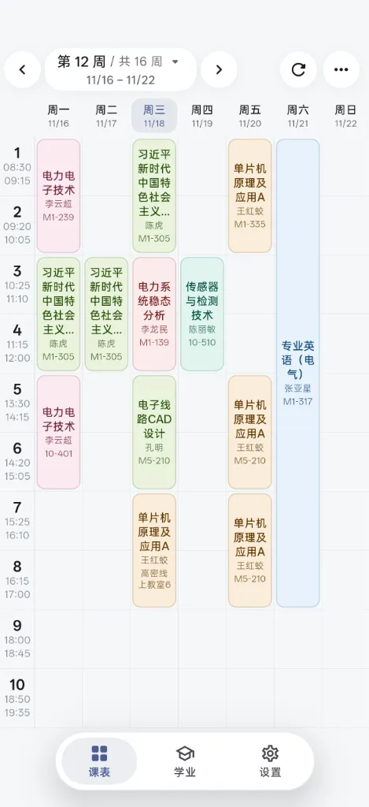
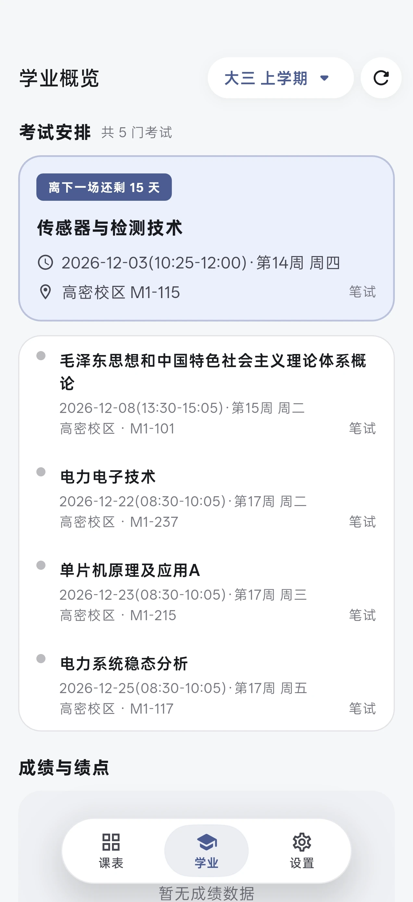
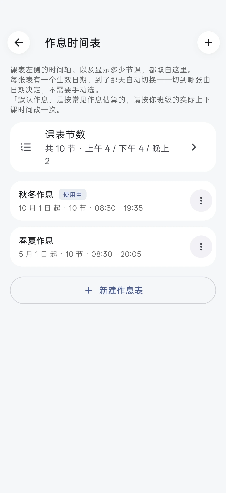

<div align="center">


# 青科课表通

<a href="https://github.com/fangzi2006/QustSchedule/releases"></a>


**[下载 APK / Windows 客户端](https://github.com/fangzi2006/QustSchedule/releases/latest) · [界面预览](#界面预览) · [功能特性](#功能特性) · [快速开始](#快速开始)**

✨ **专为青科大学生打造的现代化轻量课表工具 · 移动端与桌面端双平台支持** ✨

</div>

## 界面预览

<table>
  <tr>
    <th>周视图课表</th>
    <th>学业概览</th>
    <th>多套作息表</th>
  </tr>
  <tr>
    <td></td>
    <td></td>
    <td></td>
  </tr>
</table>

## 功能特性

### 📅 课表展示与管理

- **一次登录，长期免登**：账号密码加密保存在本机安全存储区，登录状态过期后自动后台重登，连续失败自动熔断防锁号。
- **周视图与一键回本周**：支持左右滑动翻周，不在本周时右下角自动出现「今」按钮一键返回；点击课程可查看教室、教师、周次与学分详情。
- **个性化外观**：课表格子高度、文字大小均可自由调节，教室与教师信息支持分别开关。
- **实践课备注与冲突提醒**：课表下方可展开或隐藏实践环节等备注课程；同一时间段有多门课时，日期栏与卡片自动标出冲突，点击可查看全部重叠课程。

### 🎓 学业概览与考试成绩

- **考试与成绩查询**：按学期查看考试安排与课程成绩，当前学期考试自动标注所在周次与星期，已结束考试自动沉底，并自动统计学期绩点。
- **未评教清晰提示**：遇到教务系统未完成评教拦截时给出明确提示，同时保留本地已有记录不丢失。

### ⏰ 作息与调课

- **多套作息自动切换**：可分别设置夏季、冬季等多套作息表，到达生效日期后自动切换，无需手动更改。
- **一键生成与逐节微调**：支持按课程时长、小课间与大课间一键生成整套作息，也可以单独微调每一节课的起止时间。
- **临时调课**：支持将某天的课程整体挪到另一天展示（如节假日调休），随时可改可删，不影响教务系统原始数据。

### 🔔 课前提醒（仅 Android）

- **普通通知与流体云卡片**：支持横幅通知显示课程、时间、地点与教师；在 ColorOS 等系统上支持流体云实时活动卡片，状态栏与息屏实时显示倒计时（需在系统通知设置中开启「流体云显示实时活动」）。
- **灵活提前量**：支持 1~60 分钟自由滑动调节，并提供 5/10/15/20/30 分钟快捷档位。
- **息屏准时且省电**：依托系统精确闹钟触发，无需后台常驻；自动规划未来 14 天提醒，重启手机后自动恢复。
- **权限自检与即时测试**：一屏查看通知、电池优化、精确闹钟与自启动权限状态并直达系统设置，内置「立即通知」与延迟测试功能方便排查。

### 🧩 桌面小组件（仅 Android）

- **三种实用样式**：
  - **今日课表**：按时间轴展示当天课程，支持融合近期考试，当天课后可自动预告明日课表。
  - **本周课表**：一屏完整呈现整周课表网格，自动高亮今天。
  - **下一节课**：轻量展示当前上课或下一节待上课程，支持宽/窄版切换。
- **自由定制与实时预览**：提供多套精选预设，支持浅色/深色/跟随系统/壁纸取色、纯透明及透明度、圆角、字号与信息密度调节，应用内可实时预览并一键添加到桌面。
- **离线可用与自动刷新**：本地保存未来 14 天安排，修改课表、作息或调课后自动同步，并按上下课时间与跨天自动刷新。

### 🚀 应用内自动更新

- **后台静默下载**：启动时自动检查新版本，支持在弹窗内直接下载或切到后台下载，随时可从课表顶栏查看进度与安装。
- **国内加速代理**：内置多个镜像加速节点，支持一键测速、多线程加速下载与自定义代理地址。

### 🔒 安全与多线路

- **隐私安全**：密码不明文存储，退出登录立即彻底清除本地账号与登录状态。
- **多教务线路切换**：内置青岛科技大学 6 条常用教务线路，某条线路卡顿或维护时可一键切换并自动重新登录。
- **内置调试信息**：可查看最近请求记录与课表解析结果并一键复制，方便遇到异常时快速排查（敏感信息全程隐藏）。


## 快速开始

### 首次配置

1. **登录教务**：输入学号与密码点击登录，登录成功后课表数据会自动缓存到本地，无网环境亦可离线浏览。
2. **校准当前周次**：正方教务系统本身不返回开学日期，首次使用如发现当前周次有偏差，可在设置页点击「校准当前周次」，选择当前实际教学周后系统会自动反推开学日并持久化。
3. **核对作息表**：前往 设置 →「作息时间表」，根据自己校区和年级核对节数与起止时间（默认预设为青岛科技大学高密校区作息表）。
4. **开启课前提醒（Android）**：前往 设置 →「课程提醒」，开启总开关并根据页面提示开启「通知权限」、「精确闹钟」并允许「后台无限制运行」。

### 常用操作技巧

- **切周与回正**：在课表页左右滑动或点击顶部箭头翻周；翻离当前周时，右下角浮出「今」按钮，点击回弹到本周。
- **弹性菜单与长按手势**：点击或长按右上角「⋯」、顶部周次或学期等按钮可原地弹性展开菜单，支持滑选操作,点击空白区域关闭。
- **状态弹窗与自由复制**：点击右上角刷新图标可在后台拉取最新课表，拉取进度与报错收敛在右上角浮层弹窗或底部轻胶囊中；课程详情、调试页与协议信息均支持长按自由选字复制。


## 技术架构

- **跨平台框架**：Flutter 3.47.7 / Dart 3.13.5（支持 Android 与 Windows 桌面端）。
- **极简依赖原则**：
  - 核心运行时仅依赖 `flutter_secure_storage`（加密凭据）、`path_provider`（私有路径）、`crypto`（本地摘要/签名运算）、`url_launcher`（外部链接跳转）。
- **协议层解耦（`zf_academic`）**：
  - 教务交互与协议解析全部封装在子模块 `packages/zf_academic` 中，为**纯 Dart 实现（零 Flutter 引擎依赖）**。

## 目录结构

```
qustschedule/
├── lib/
│   ├── main.dart                      应用入口：全局生命周期、状态路由
│   ├── src/
│   │   ├── app_model.dart             核心门面状态机：统筹会话、冷启动、前后台调度
│   │   ├── app_version.dart           应用版本号管理（运行时读取 pubspec.yaml）
│   │   ├── state/                     五大细粒度控制器（auth_session/schedule/academic/preferences/hint_notice）
│   │   ├── updater/                   应用内更新状态机、多线程下载器、Windows/Android 安装器
│   │   ├── schedule_service.dart      课表拉取编排：Cookie 优先、全局 Mutex Flight、熔断与降级
│   │   ├── academic_service.dart      学业编排：考试/成绩拉取、未评教拦截诊断、原生 GPA 统计
│   │   ├── academic_cache.dart        学业离线缓存（ExamCache、GradesCache，按学期 JSON 隔离落盘）
│   │   ├── backends.dart              教务协议抽象接口
│   │   ├── schedule_cache.dart        课表本地离线缓存
│   │   ├── safe_json_file.dart        原子写入、滚动备份自愈与 Isolate 阈值后台编解码
│   │   ├── reschedule.dart            调课规则引擎与冲突计算
│   │   ├── term_calendar.dart         周次 ↔ 日期转换、同日排课布局
│   │   ├── term_selector_helper.dart  学期选择与显示辅助
│   │   ├── timetable.dart             作息表模型与节次快捷运算
│   │   ├── course_text.dart           卡片文字自适应缩放与截断排版
│   │   ├── formatted_text_span.dart   轻量更新日志行内富文本解析
│   │   ├── route_settled.dart         二级页转场落稳后的延迟任务调度工具
│   │   ├── preferences_repository.dart 用户偏好持久化（Schema 14，向下兼容）
│   │   ├── credentials_repository.dart 凭据安全存储（Keystore / DPAPI）
│   │   ├── session_repository.dart    Cookie 容器快照持久化
│   │   ├── reminder_planner.dart      提醒规划纯函数：事件生成、指纹、14 天窗口
│   │   ├── reminder_gateway.dart      原生闹钟与提醒通道抽象（MethodChannel）
│   │   ├── reminder_service.dart      提醒编排：防抖聚合、去重与重试
│   │   ├── widget_style.dart          桌面小组件外观样式与配置模型
│   │   ├── widget_planner.dart        桌面小组件 14 天快照规划纯函数
│   │   ├── widget_gateway.dart        桌面小组件原生通道抽象（MethodChannel）
│   │   ├── widget_service.dart        桌面小组件防抖同步与状态编排
│   │   └── school.dart                青科大教务线路配置
│   ├── pages/                         首页外壳 / 课表 / 学业 / 设置 / 提醒 / 小组件 / 作息 / 调课 / 更新 / 调试等页面
│   ├── widgets/                       触感按钮与四层合绘 / 弹性菜单 / 浮动 Dock / 悬浮胶囊 / 小组件预览 / 课表组件
│   └── theme/                         Material 3 语义色令牌与课程调色板
├── packages/zf_academic/              独立教务协议层库（纯 Dart 核心，含 Isolate Cookie 存储）
├── test/                              单元、状态机、UI 性能契约与并发回归测试
├── docs/                              项目文档、Logo 与界面预览截图
├── android/                           Android 原生工程（Kotlin + AlarmManager + 流体云 + 桌面小组件）
├── windows/                           Windows 原生工程（CMake + MSVC + 单实例互斥锁 + Inno Setup）
├── .github/workflows/                 GitHub Actions 持续集成与多端自动发版
└── pubspec.yaml                       项目包配置与版本号定义
```

## 已知限制与注意事项

1. **学校专属**：当前版本主要适配青岛科技大学新正方教务系统，未对其他高校做多校定制。
2. **周次校准**：教务系统接口不返回标准开学日期，初次使用建议对照教务日历校准一次当前教学周。
3. **Android 提醒后台保活**：由于部分国产系统强杀机制，若使用了「强行停止」或系统的「一键深度清理」，系统会清除已挂载的闹钟；此时重新打开一次应用即可全自动恢复。

## 开源协议

本项目基于 [GNU General Public License v3.0](LICENSE) 协议开源。
