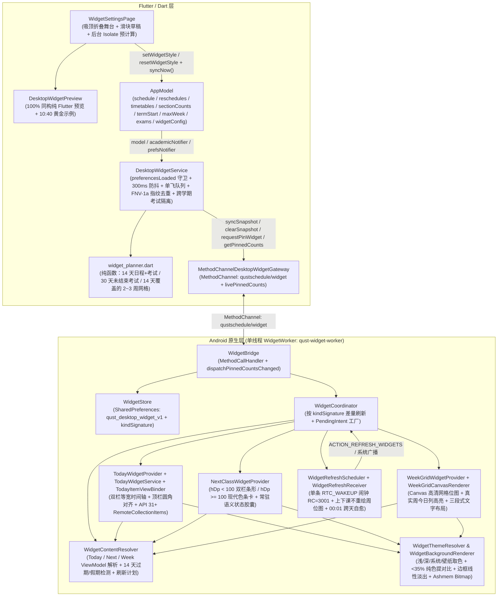

# Android 桌面小组件架构与全量技术参考手册 (`WIDGET.md`)

> **文档定位**：面向 AI 检索优化的「青科课表通」Android 桌面小组件（**今日课表 `today`**、**本周课表 `week`**、**下一节课 `next`**）权威技术契约。涵盖 Dart 规划器与服务层、Flutter 配置与同构预览页、MethodChannel 协议与 JSON Schema、15 个 Kotlin 原生渲染/调度源码、XML 资源声明及 4 个守护测试套件的全部精确签名、常量与状态机。阅读本文档即可直接定位与修改代码，无需重复通读源码文件。

---

## 目录与锚点速查 (Quick TOC)

- [1. 快速索引表 (Quick AI File & Symbol Index)](#1-快速索引表-quick-ai-file--symbol-index)
- [2. 常见改动定位速查表 (Where to Edit for Common Tasks)](#2-常见改动定位速查表-where-to-edit-for-common-tasks)
- [3. 全局分层与数据流架构 (Architecture & Data Flow)](#3-全局分层与数据流架构-architecture--data-flow)
- [4. 样式配置系统与预设规范 (`widget_style.dart` / `WidgetStore.kt`)](#4-样式配置系统与预设规范-widget_styledart--widgetstorekt)
- [5. 离线快照规划与指纹算法 (`widget_planner.dart`)](#5-离线快照规划与指纹算法-widget_plannerdart)
- [6. MethodChannel 协议与 JSON Schema (`qustschedule/widget`)](#6-methodchannel-协议与-json-schema-qustschedulewidget)
- [7. Flutter 编排服务契约 (`DesktopWidgetService`)](#7-flutter-编排服务契约-desktopwidgetservice)
- [8. Android 原生线程、存储与差量协调 (`WidgetWorker` / `WidgetStore` / `WidgetCoordinator`)](#8-android-原生线程存储与差量协调-widgetworker--widgetstore--widgetcoordinator)
- [9. 纯逻辑视图解析与刷新计划 (`WidgetContentResolver`)](#9-纯逻辑视图解析与刷新计划-widgetcontentresolver)
- [10. 主题配色、动态取色与背景渲染 (`WidgetThemeResolver` / `WidgetBackgroundRenderer`)](#10-主题配色动态取色与背景渲染-widgetthemeresolver--widgetbackgroundrenderer)
- [11. 三类小组件原生渲染规范 (`Today` / `Next` / `WeekGrid`)](#11-三类小组件原生渲染规范-today--next--weekgrid)
- [12. 靶向节点闹钟与广播恢复 (`WidgetRefreshScheduler` / `WidgetRefreshReceiver`)](#12-靶向节点闹钟与广播恢复-widgetrefreshscheduler--widgetrefreshreceiver)
- [13. 配置页与同构预览 UI 契约 (`WidgetSettingsPage` / `DesktopWidgetPreview`)](#13-配置页与同构预览-ui-契约-widgetsettingspage--desktopwidgetpreview)
- [14. XML 布局、选择器预览与 Manifest 清单索引](#14-xml-布局选择器预览与-manifest-清单索引)
- [15. 守护测试矩阵与防雷铁律清单](#15-守护测试矩阵与防雷铁律清单)

---

## 1. 快速索引表 (Quick AI File & Symbol Index)

> 所有相对路径均以仓库根目录 `qustschedule/` 为基准。

### 1.1 Dart 核心与 UI 层 (`lib/`)

| 文件路径 | 核心类 / 函数 | 核心职责 | 关键方法 / 常量 / 字段 |
|---|---|---|---|
| [`lib/src/widget_style.dart`](../../lib/src/widget_style.dart) | `DesktopWidgetKind`, `WidgetThemeMode`, `WidgetDensity`, `FinishedCourseMode`, `WeekendColumnMode`, `WidgetStylePreset`, `WidgetStylePresetSpec`, `DesktopWidgetStyle`, `DesktopWidgetConfigSet` | 3 类小组件独立样式模型、5 套精选预设注册表、数值夹取量化、JSON 序列化容错 | `widgetStylePresets`, `widgetMinOpacity` (`0.0`), `widgetMaxOpacity` (`1.0`), `widgetMinCornerRadius` (`8.0`), `widgetMaxCornerRadius` (`28.0`), `widgetMinFontScale` (`0.75`), `widgetMaxFontScale` (`1.20`), `clampWidgetOpacity`, `clampWidgetCornerRadius`, `clampWidgetFontScale`, `applyPreset()`, `copyWith()`, `defaultsFor()` |
| [`lib/src/widget_planner.dart`](../../lib/src/widget_planner.dart) | `WidgetTimelineItem`, `WidgetDayPlan`, `WidgetUpcomingExam`, `WidgetWeekBlock`, `WidgetWeekPlan`, `WidgetSnapshot`, `buildWidgetSnapshot()`, `buildSignedOutWidgetSnapshot()` | 纯函数离线规划器：计算未来 14 天日程+考试混排、30 天未结束考试、14 天覆盖的 2~3 周网格（含调课与冲突分栏）及 FNV-1a 32 位指纹 | `widgetSnapshotVersion` (`1`), `widgetHorizonDays` (`14`), `widgetUpcomingExamWindowDays` (`7`), `widgetExamSnapshotMaxDays` (`30`), `_computeSnapshotFingerprint()`, `_fnv1a()`, `_stableCourseId` (`c_<hex8>`), `_stableExamId` (`x_<hex8>`) |
| [`lib/src/widget_gateway.dart`](../../lib/src/widget_gateway.dart) | `DesktopWidgetGateway`, `MethodChannelDesktopWidgetGateway` | `qustschedule/widget` 平台通道窄接口封装与原生实例计数反向推送监听 | `syncSnapshot(payloadJson)`, `clearSnapshot()`, `requestPinWidget(kind)`, `getPinnedCounts()`, `livePinnedCounts` (`ValueNotifier`), `ensurePushHandlerInstalled()` |
| [`lib/src/widget_service.dart`](../../lib/src/widget_service.dart) | `WidgetSnapshotInput`, `DesktopWidgetService` | 监听 `AppModel` / `academicNotifier` / `prefsNotifier`，执行 `preferencesLoaded` 守卫、300ms 防抖、单飞串行队列、指纹去重与跨学期考试隔离 | `syncNow({bool force = false})`, `captureSnapshotInput()`, `buildSnapshot()`, `clearAll()`, `requestPinWidget()`, `getPinnedCounts()`, `ensureLivePinnedUpdates()`, `_syncEpoch` |
| [`lib/pages/widget_settings_page.dart`](../../lib/pages/widget_settings_page.dart) | `WidgetSettingsPage`, `computeWidgetSettingsSnapshots()`, `_PreviewStageHeaderDelegate`, `_KindSegmentedHeader`, `_PresetStrip`, `_ZOrderedRow`, `_LabeledSliderTile`, `_WidgetTickedTrackShape` | 桌面小组件配置与实时预览页（吸顶折叠预览舞台、后台 Isolate 首屏快照预计算、滑块草稿拖动与抬手提交、恢复默认撤销、Z-order 触控置顶） | `_opacityDraft`, `_radiusDraft`, `_fontScaleDraft`, `_useSampleData`, `_todayNarrow`, `_nextWide`, `_wallpaper`, `_pinnedCounts`, `_commitStyle()`, `_resetCurrentKind()`, `_pinSelectedWidget()` |
| [`lib/widgets/desktop_widget_preview.dart`](../../lib/widgets/desktop_widget_preview.dart) | `DesktopWidgetPreview`, `PreviewWallpaper`, `samplePreviewClock()`, `buildSampleWidgetSnapshot()`, `_PreviewColors`, `_TodayPreviewCard`, `_WeekPreviewCard`, `_NextPreviewCard` | 与 Android 原生像素级同构的纯 Flutter 预览组件（含 10:40 黄金示例快照生成、周网格三段式文字排版求解器、系统字体缩放隔离） | `_resolveTodayForPreview()`, `_resolveNextForPreview()`, `_resolveWeekForPreview()`, `_solvePreviewBlockPlan()`, `_cornerClearance()` |

### 1.2 Android 原生层 (`android/app/src/main/kotlin/com/fangzi/qustschedule/widget/`)

| 文件路径 | 核心类 / 单例 | 核心职责 | 关键方法 / 常量 |
|---|---|---|---|
| [`WidgetWorker.kt`](../../android/app/src/main/kotlin/com/fangzi/qustschedule/widget/WidgetWorker.kt) | `WidgetWorker` (`object`) | 桌面小组件全局唯一后台单线程执行器（`qust-widget-worker`），封装 `BroadcastReceiver.goAsync()` | `execute(task)`, `runBroadcastAsync(receiver, tag, block)` |
| [`WidgetBridge.kt`](../../android/app/src/main/kotlin/com/fangzi/qustschedule/widget/WidgetBridge.kt) | `WidgetBridge` | `MainActivity` 挂载的 `qustschedule/widget` `MethodCallHandler`，将写盘与重绘派发至 `WidgetWorker`，并回推 `onPinnedCountsChanged` | `CHANNEL = "qustschedule/widget"`, `attach()`, `dispose()`, `onMethodCall()`, `dispatchPinnedCountsChanged(counts)` |
| [`WidgetStore.kt`](../../android/app/src/main/kotlin/com/fangzi/qustschedule/widget/WidgetStore.kt) | `WidgetStore` (`object`), `WidgetSnapshotModel`, `WidgetStyleData`, `TimelineItemData`, `DayPlanData`, `UpcomingExamData`, `WeekBlockData`, `WeekPlanData` | `SharedPreferences` (`qust_desktop_widget_v1`) 同步读写、JSON 容错反序列化、按类型 `kindSignature(kind)` 差量摘要计算 | `KIND_TODAY = "today"`, `KIND_WEEK = "week"`, `KIND_NEXT = "next"`, `saveSnapshot()`, `loadSnapshot()`, `saveTodayHeaderSig()`, `saveTodayWidthDp()`, `bumpTodayRevision()`, `saveLastWeekRenderDateIso()`, `clear()` |
| [`WidgetContentResolver.kt`](../../android/app/src/main/kotlin/com/fangzi/qustschedule/widget/WidgetContentResolver.kt) | `WidgetContentResolver` (`object`), `TodayWidgetViewModel`, `NextWidgetViewModel`, `WeekWidgetViewModel`, `NextStatusKind`, `WidgetRefreshPlan` | 纯逻辑视图解析器：从 `WidgetSnapshotModel` + `nowMs` 推导三类小组件 ViewModel、14 天过期/假期结束判断、下一次精准闹钟计划 | `UPCOMING_EXAM_WINDOW_DAYS = 7`, `resolveToday()`, `resolveNext()`, `resolveWeek()`, `computeNextRefreshPlan()`, `formatTimeRange()`, `calendarDayDiff()` |
| [`WidgetThemeResolver.kt`](../../android/app/src/main/kotlin/com/fangzi/qustschedule/widget/WidgetThemeResolver.kt) | `WidgetThemeResolver` (`object`), `ResolvedWidgetTheme`, `CourseChipColor`, `WidgetPillTone` | 主题色彩解析（浅/深/跟随系统/Android 12+ 动态壁纸取色）、`<35%` 低透明纯色提对比、边框线性淡出、9 色课程色板、API 24–30 圆角与竖条着色兼容 | `LIGHT_COURSE_COLORS`, `DARK_COURSE_COLORS`, `resolve()`, `applyPill()`, `applyRoundedBackground()`, `clearBackground()`, `applyVerticalBar()` |
| [`WidgetBackgroundRenderer.kt`](../../android/app/src/main/kotlin/com/fangzi/qustschedule/widget/WidgetBackgroundRenderer.kt) | `WidgetBackgroundRenderer` (`object`) | RemoteViews 动态圆角半透明背景 Bitmap 绘制、横竖屏真实 `wDp × hDp` 解析、圆角安全内缩计算、不可变 Ashmem Bitmap 转换 | `MAX_BG_DIMENSION_PX = 1080`, `resolveSizeDp()`, `cornerClearanceDp()`, `render()`, `toImmutableAshmemFriendly()` |
| [`WidgetCoordinator.kt`](../../android/app/src/main/kotlin/com/fangzi/qustschedule/widget/WidgetCoordinator.kt) | `WidgetCoordinator` (`object`), `ActiveWidgetFlags` | 跨小组件差量重绘（按 `kindSignature` + `lastWeekRenderDateIso`）、闹钟靶向刷新、桌面实例统计与 `PendingIntent` 工厂 | `RC_LAUNCH_IMMUTABLE = 3101`, `RC_LAUNCH_TEMPLATE = 3102`, `RC_PIN_CALLBACK = 3103`, `refreshChangedWidgets()`, `refreshAllWidgets()`, `refreshForScheduledAlarm()`, `syncAlarmState()`, `getPinnedCounts()` |
| [`WidgetRefreshScheduler.kt`](../../android/app/src/main/kotlin/com/fangzi/qustschedule/widget/WidgetRefreshScheduler.kt) | `WidgetRefreshScheduler` (`object`) | 单条 `RTC_WAKEUP` 节点闹钟（`RC=3001`）调度与取消，复用 `ReminderPermissions.canScheduleExactAlarms` 降级 | `ACTION_REFRESH_WIDGETS`, `ACTION_WIDGET_PINNED`, `EXTRA_INCLUDE_WEEK = "include_week"`, `RC_WIDGET_REFRESH = 3001`, `scheduleNext()`, `cancel()` |
| [`WidgetRefreshReceiver.kt`](../../android/app/src/main/kotlin/com/fangzi/qustschedule/widget/WidgetRefreshReceiver.kt) | `WidgetRefreshReceiver` | 接收节点闹钟、Pin 回调、开机、覆盖安装、时间/时区/日期变更与精确闹钟权限变更广播 | `onReceive()` |
| [`TodayWidgetProvider.kt`](../../android/app/src/main/kotlin/com/fangzi/qustschedule/widget/TodayWidgetProvider.kt) | `TodayWidgetProvider` | 「今日课表」`AppWidgetProvider`：顶栏与外框边距计算、API 31+ `RemoteCollectionItems` / API 24–30 `TodayWidgetService` 绑定、考试倒计时横幅 | `headerSignature()`, `updateAll()`, `updateWidgetById()`, `bindListItems()`, `bindExamBanner()` |
| [`TodayWidgetService.kt`](../../android/app/src/main/kotlin/com/fangzi/qustschedule/widget/TodayWidgetService.kt) | `TodayWidgetService`, `TodayRemoteViewsFactory` | API 24–30 `ListView` `RemoteViewsService` 适配器，含 `onDataSetChanged()` 顶栏签名校验与异步自愈 | `onGetViewFactory()`, `onDataSetChanged()`, `getViewAt()` |
| [`TodayItemViewBinder.kt`](../../android/app/src/main/kotlin/com/fangzi/qustschedule/widget/TodayItemViewBinder.kt) | `TodayItemViewBinder` (`object`) | 今日课表双栏时间轴单行渲染器（固定宽等宽时间列 + 确定性高度圆角竖条 + 状态胶囊 + 课名/地点·教师 + 进行中底色高亮） | `isNarrowWidth(widthDp)` (`< 200`), `buildItemView()` |
| [`NextClassWidgetProvider.kt`](../../android/app/src/main/kotlin/com/fangzi/qustschedule/widget/NextClassWidgetProvider.kt) | `NextClassWidgetProvider` | 「下一节课」`AppWidgetProvider`：按 `hDp < 100` 自适应切换条形双栏 (`widget_next_wide`) 与现代卡片 (`widget_next`) | `updateAll()`, `isStrip` (`hDp < 100`), `isUltraCompactStrip` (`isStrip && wDp < 195`), `isSpaciousTall` (`!isStrip && wDp >= 220`) |
| [`WeekGridWidgetProvider.kt`](../../android/app/src/main/kotlin/com/fangzi/qustschedule/widget/WeekGridWidgetProvider.kt) | `WeekGridWidgetProvider` | 「本周课表」`AppWidgetProvider`：调用 `WeekGridCanvasRenderer` 生成整张高清网格位图并写入 `last_week_render_date_iso` | `updateAll()`, `updateWidgetWithSnapshot()` |
| [`WeekGridCanvasRenderer.kt`](../../android/app/src/main/kotlin/com/fangzi/qustschedule/widget/WeekGridCanvasRenderer.kt) | `WeekGridCanvasRenderer` (`object`) | 原生 Canvas 整周课表绘制器：动态像素上限缩放、单行星期表头、真实周今日列高亮、自适应节次轴、三段式课程块排版求解与青蓝调课圆点 | `MIN_PIXELS_CEILING = 640_000f`, `MAX_PIXELS_CEILING = 1_050_000f`, `render()`, `solveCourseBlockPlan()`, `buildBlockLayout()` |

---

## 2. 常见改动定位速查表 (Where to Edit for Common Tasks)

| 工程任务场景 | 必须修改的目标文件与位置 | 同步与验证约束 |
|---|---|---|
| **新增/修改精选预设风格** | [`lib/src/widget_style.dart`](../../lib/src/widget_style.dart) → `WidgetStylePreset` 枚举 + `widgetStylePresets` 列表 | 预设**仅绑定** `themeMode`、`backgroundOpacity`（必须是 **5% 步进倍数**）与 `cornerRadius`，**严禁覆盖** `density`、`fontScale` 或内容开关；运行 `test/widget_style_test.dart` |
| **调整透明度/圆角/字号范围或步进** | 1. [`lib/src/widget_style.dart`](../../lib/src/widget_style.dart) → `widgetMin*` / `widgetMax*` 及 `clampWidget*()`<br>2. [`WidgetStore.kt`](../../android/app/src/main/kotlin/com/fangzi/qustschedule/widget/WidgetStore.kt) → `WidgetStyleData.fromJson` 中的 `optFiniteFloat(..., minValue, maxValue)`<br>3. [`lib/pages/widget_settings_page.dart`](../../lib/pages/widget_settings_page.dart) → `_LabeledSliderTile` 的 `divisions` / `defaultValue` | Dart 与 Kotlin 的 clamp 上下限必须完全一致（当前：透明度 `0.0..1.0` 20 档，圆角 `8..28dp` 20 档，字号 `0.75..1.20` 9 档） |
| **新增单个外观/内容开关字段** | 1. [`lib/src/widget_style.dart`](../../lib/src/widget_style.dart) → `DesktopWidgetStyle`（构造、默认值、`applyPreset`、`copyWith`、`toJson`、`fromJson`、`==`、`hashCode`）<br>2. [`WidgetStore.kt`](../../android/app/src/main/kotlin/com/fangzi/qustschedule/widget/WidgetStore.kt) → `WidgetStyleData`（属性与 `fromJson` 向后兼容默认值）<br>3. [`lib/pages/widget_settings_page.dart`](../../lib/pages/widget_settings_page.dart) → 按小组件形态条件展示开关<br>4. [`lib/widgets/desktop_widget_preview.dart`](../../lib/widgets/desktop_widget_preview.dart) & 原生 `WidgetContentResolver.kt` / 对应 Provider 或 Renderer | 新增字段在 `fromJson` 缺失时必须回退 `base.<field>`，无需递增 `Preferences` schema 版本（当前为 schema 15）；若为视觉属性需评估是否触发 `visualChanged -> WidgetStylePreset.custom` |
| **修改课程卡片色板（浅色/深色 9 色）** | 1. [`lib/theme/course_palette.dart`](../../lib/theme/course_palette.dart) → `CoursePalette.colors` / `CoursePalette.darkColors`<br>2. [`WidgetThemeResolver.kt`](../../android/app/src/main/kotlin/com/fangzi/qustschedule/widget/WidgetThemeResolver.kt) → `LIGHT_COURSE_COLORS` / `DARK_COURSE_COLORS` | 两端 9 组 `background` / `foreground` ARGB 十六进制值及顺序必须 **100% 像素级一致** |
| **修改语义胶囊/文字/背景/边框对比度** | 1. [`WidgetThemeResolver.kt`](../../android/app/src/main/kotlin/com/fangzi/qustschedule/widget/WidgetThemeResolver.kt) → `WidgetThemeResolver.resolve()`<br>2. [`lib/widgets/desktop_widget_preview.dart`](../../lib/widgets/desktop_widget_preview.dart) → `_PreviewColors.resolve()`<br>3. 若涉及 API 24–30 静态回退色，同步检查 `android/app/src/main/res/drawable/widget_pill_*.xml` 与 `widget_row_highlight_*.xml` | 严禁在 `0%` 透明或低透明度下给文字加阴影；修改后确保 `_PreviewColors` 与 `WidgetThemeResolver` 完全同构 |
| **修改今日/下一节/本周的展示文案或筛选逻辑** | 1. [`WidgetContentResolver.kt`](../../android/app/src/main/kotlin/com/fangzi/qustschedule/widget/WidgetContentResolver.kt) → `resolveToday()` / `resolveNext()` / `resolveWeek()`<br>2. [`lib/widgets/desktop_widget_preview.dart`](../../lib/widgets/desktop_widget_preview.dart) → `_resolveTodayForPreview()` / `_resolveNextForPreview()` / `_resolveWeekForPreview()` | Kotlin 原生解析器与 Dart 预览解析器必须保持 **100% 逻辑与文案同构** |
| **修改周课表网格格子内课名/教师/地点行数分配** | 1. [`WeekGridCanvasRenderer.kt`](../../android/app/src/main/kotlin/com/fangzi/qustschedule/widget/WeekGridCanvasRenderer.kt) → `solveCourseBlockPlan()`<br>2. [`lib/widgets/desktop_widget_preview.dart`](../../lib/widgets/desktop_widget_preview.dart) → `_solvePreviewBlockPlan()` | 必须与主课表页 `CourseBlock._BlockPlan` 的降级/回填优先级保持一致 |
| **新增第 4 种小组件形态** | 1. [`lib/src/widget_style.dart`](../../lib/src/widget_style.dart) → `DesktopWidgetKind` 增加枚举项<br>2. `android/.../widget/` → 新增 `*WidgetProvider.kt` + `res/xml/widget_*_info.xml` + `res/layout/widget_*.xml` + `AndroidManifest.xml` `<receiver>`<br>3. [`WidgetStore.kt`](../../android/app/src/main/kotlin/com/fangzi/qustschedule/widget/WidgetStore.kt) → 增加 `KIND_*` 常量、`styles` 解析与 `kindSignature()` 分支<br>4. [`WidgetCoordinator.kt`](../../android/app/src/main/kotlin/com/fangzi/qustschedule/widget/WidgetCoordinator.kt) → 纳入 `ActiveWidgetFlags`、`refreshChangedWidgets`、`getPinnedCounts`、`componentForKind` | 确保 `WidgetContentResolver.computeNextRefreshPlan` 按新增形态是否依赖上下课节点决定闹钟唤醒策略 |

---

## 3. 全局分层与数据流架构 (Architecture & Data Flow)



---

## 4. 样式配置系统与预设规范 (`widget_style.dart` / `WidgetStore.kt`)

### 4.1 枚举定义与 Wire 协议值

| 枚举类名 | 枚举项 (`wireName` → `label` / 附加属性) | 默认回退值 (`parse(null/unknown)`) |
|---|---|---|
| `DesktopWidgetKind` | `today` (`'today'`, `'今日课表'`, `sizeHint: '4×2 / 2×2 · 时间轴'`)<br>`week` (`'week'`, `'本周课表'`, `sizeHint: '4×4 · 整周网格'`)<br>`next` (`'next'`, `'下一节课'`, `sizeHint: '2×2 / 4×1 · 精简卡'`) | `DesktopWidgetKind.today` |
| `WidgetThemeMode` | `light` (`'light'`, `'浅色'`) · `dark` (`'dark'`, `'深色'`) · `system` (`'system'`, `'跟随系统'`) · `dynamic` (`'dynamic'`, `'壁纸取色'`) | `WidgetThemeMode.light` |
| `WidgetDensity` | `compact` (`'compact'`, `'紧凑'`) · `comfortable` (`'comfortable'`, `'舒适'`) | `WidgetDensity.comfortable` |
| `FinishedCourseMode` | `dim` (`'dim'`, `'置灰'`) · `hide` (`'hide'`, `'自动隐藏'`) · `normal` (`'normal'`, `'正常显示'`) | `FinishedCourseMode.dim` |
| `WeekendColumnMode` | `auto` (`'auto'`, `'有课显示'`) · `show` (`'show'`, `'始终显示'`) · `hide` (`'hide'`, `'始终隐藏'`) | `WeekendColumnMode.auto` |
| `WidgetStylePreset` | `minimalWhite` (`'minimal_white'`, `'极简纯白'`)<br>`frostedGlass` (`'frosted_glass'`, `'通透磨砂'`)<br>`darkNight` (`'dark_night'`, `'暗夜模式'`)<br>`pureTransparent` (`'pure_transparent'`, `'纯净透明'`)<br>`materialYou` (`'material_you'`, `'莫奈取色'`)<br>`custom` (`'custom'`, `'自定义'`) | `WidgetStylePreset.minimalWhite` |

> **命名隔离契约**：预设 `WidgetStylePreset.materialYou` 文案为 **`'莫奈取色'`**，色彩主题 `WidgetThemeMode.dynamic` 文案为 **`'壁纸取色'`**，避免同页面内两个控件出现重名标签（由 `test/widget_style_test.dart` 守护）。

### 4.2 内置 5 套精选预设注册表 (`widgetStylePresets`)

> **解耦铁律**：调用 `style.applyPreset(target)` **仅更新** `preset`、`themeMode`、`backgroundOpacity`、`cornerRadius` 四个视觉字段，**原样保留**用户的 `fontScale`、`density` 及所有布尔/枚举内容开关。

| 预设枚举 (`wireName`) | 名称 (`label`) | 副标题 (`subtitle`) | `themeMode` | `backgroundOpacity` | `cornerRadius` |
|---|---|---|---|---|---|
| `minimalWhite` (`minimal_white`) | 极简纯白 | 纯白清爽底色 | `light` | `1.0` (100%) | `20.0` |
| `frostedGlass` (`frosted_glass`) | 通透磨砂 | 半透明玻璃质感 | `system` | `0.75` (75%) | `22.0` |
| `darkNight` (`dark_night`) | 暗夜模式 | 深邃柔和暗色 | `dark` | `0.90` (90%) | `20.0` |
| `pureTransparent` (`pure_transparent`) | 纯净透明 | 无底融入壁纸 | `dark` | `0.0` (0%) | `20.0` |
| `materialYou` (`material_you`) | 莫奈取色 | 随壁纸动态配色 · Android 12+ | `dynamic` | `0.90` (90%) | `24.0` |

### 4.3 `DesktopWidgetStyle` / `WidgetStyleData` 全字段规格表

| 字段名 (JSON Key) | Dart 类型 | Kotlin 类型 | 默认值 (`today` / `next`) | 默认值 (`week`) | 夹取范围 / 量化规则 | 适用形态与 UI 暴露规则 |
|---|---|---|---|---|---|---|
| `preset` | `WidgetStylePreset` | `String` | `minimalWhite` | `minimalWhite` | 未知字符串回退 `minimalWhite`；当 `copyWith` 修改了 `themeMode` / `backgroundOpacity` / `cornerRadius` 且未显式传 `preset` 时自动变为 `custom` | 全部形态（横向预设条仅展示 5 套具名预设，`custom` 态无预设高亮） |
| `themeMode` | `WidgetThemeMode` | `String` | `light` | `light` | `'light'` / `'dark'` / `'system'` / `'dynamic'` | 全部形态（选中 `dynamic` 时显示 Android 12+ 辅助说明） |
| `backgroundOpacity` | `double` | `Float` | `1.0` | `1.0` | `[0.0, 1.0]`，`clampWidgetOpacity` 按 `1%` (`0.01`) 量化，UI 滑块 `divisions: 20`（5% 步进），`NaN` 回退 `1.0` | 全部形态 |
| `cornerRadius` | `double` | `Float` | `20.0` | `20.0` | `[8.0, 28.0]`，`clampWidgetCornerRadius` 取整 `roundToDouble()`，UI 滑块 `divisions: 20`（1dp 步进），`NaN` 回退 `20.0` | 全部形态；**当 `backgroundOpacity <= 0.01`（0% 纯透明）时在 UI 配置页隐藏此滑块** |
| `fontScale` | `double` | `Float` | `1.0` | `1.0` | `[0.75, 1.20]`，`clampWidgetFontScale` 按 `5%` (`1/20 = 0.05`) 量化，UI 滑块 `divisions: 9`（9 档：75%..120%），`NaN` 回退 `1.0` | 全部形态 |
| `density` | `WidgetDensity` | `String` | `comfortable` | `comfortable` | `'compact'` / `'comfortable'` | 仅 **`today`**、**`week`** 暴露；**`next` 隐藏此项** |
| `showHeader` | `bool` | `Boolean` | `true` | `true` | 布尔值，非 `bool` 回退 `true` | 仅 **`today`**、**`week`** 暴露；**`next` 隐藏此项**（下一节课状态胶囊常驻，不受 `showHeader` 控制） |
| `showLocation` | `bool` | `Boolean` | `true` | `true` | 布尔值 | 全部形态（**控制上课地点，同时控制考试条目的座位号 `${seatNumber}座` 显示与隐藏**） |
| `showTeacher` | `bool` | `Boolean` | **`true`** | **`false`** | 布尔值（注意：`week` 默认关闭教师以防小格子拥挤，`today`/`next` 默认开启） | 全部形态 |
| `showTime` | `bool` | `Boolean` | `true` | `true` | 布尔值 | 全部形态（配置页标题随形态变化：`today` 为「显示上课时间」，`week` 为「显示左侧节次列」，`next` 为「显示起止时间」） |
| `showExams` | `bool` | `Boolean` | `true` | `true` | 布尔值 | 仅 **`today`**、**`next`** 暴露；**`week` 隐藏此项** |
| `autoSwitchTomorrow` | `bool` | `Boolean` | `true` | `true` | 布尔值（向后兼容旧 JSON 缺失时默认 `true`） | 仅 **`today`** 暴露（「课后自动切明日预告」） |
| `finishedCourseMode` | `FinishedCourseMode` | `String` | `dim` | `dim` | `'dim'` / `'hide'` / `'normal'` | 仅 **`today`** 暴露（「已结束课程」）；**`next` 隐藏此项** |
| `weekendMode` | `WeekendColumnMode` | `String` | `auto` | `auto` | `'auto'` / `'show'` / `'hide'` | 仅 **`week`** 暴露（「周末列显示」） |

### 4.4 持久化容器 (`DesktopWidgetConfigSet` & `Preferences` Schema 14)

- `DesktopWidgetConfigSet` 以 `Map<DesktopWidgetKind, DesktopWidgetStyle>` 维护三种形态的独立配置，JSON 结构为 `{"today": {...}, "week": {...}, "next": {...}}`。
- 在 [`lib/src/preferences_repository.dart`](../../lib/src/preferences_repository.dart)（Schema 14 引入，当前 `schema: 15`）中持久化于顶层键 `"widgetConfig"`。读取 `schema <= 13` 或缺失 `"widgetConfig"` 的历史配置时，自动回退 `DesktopWidgetConfigSet.defaults()`。
- `AppModel` / `PreferencesController` 暴露的方法：
  - `model.widgetConfig` → `DesktopWidgetConfigSet`
  - `model.widgetStyleOf(DesktopWidgetKind kind)` → `DesktopWidgetStyle`
  - `model.setWidgetStyle(DesktopWidgetKind kind, DesktopWidgetStyle style)` → 写入 `Preferences` 并触发 `prefsNotifier`
  - `model.resetWidgetStyle(DesktopWidgetKind kind)` → 恢复该形态为 `DesktopWidgetStyle.defaultsFor(kind)` 并触发 `prefsNotifier`

---

## 5. 离线快照规划与指纹算法 (`widget_planner.dart`)

### 5.1 核心时间窗口常量

| 常量名 | 值 | 含义与设计契约 |
|---|---|---|
| `widgetSnapshotVersion` | `1` | 快照 JSON 协议版本号（字段 `'v'`） |
| `widgetHorizonDays` | `14` | 预计算未来 **14 天**（`today + 0 .. today + 13`）的逐日日程 `days`（含当日课程与当日考试混排） |
| `widgetUpcomingExamWindowDays` | `7` | 当今日/明日无课（或课后）时，小组件展示「近期考试倒计时」的最大提前天数窗口（**7 天内**，`days <= 7`） |
| `widgetExamSnapshotMaxDays` | `30` | 快照 `upcomingExams` 列表收集未来未结束考试的最大天数上限（**30 天内**，`diffDays <= 30` 且 `endMs > nowMs`） |

### 5.2 `buildWidgetSnapshot` 规划算法详解

1. **学期周次与日期归一化**：
   - `safeMaxWeek = maxWeek < 1 ? 1 : maxWeek`
   - `mondayStart = mondayOf(termStart)`，`termStartIso = formatIsoDate(mondayStart)`
   - `today = dayOnly(now)`
2. **未来 14 天逐日时间轴 (`days`)**：
   - 遍历 `offset = 0 .. horizonDays - 1`，计算 `date = DateTime(today.year, today.month, today.day + offset)`。
   - `inTerm = !date.isBefore(mondayStart)`，`week = inTerm ? weekOf(termStart, date) : 0`。
   - **课程提取（仅当 `inTerm && week >= 1 && week <= safeMaxWeek`）**：
     - 调用 `rescheduleWeekView(entries, reschedules, termStart, week, maxWeek: safeMaxWeek)` 获取应用调课规则后的周视图；
     - 调用 `activeTimetableAt(timetables, date)` + `reconcileSections(table.sections, sectionCounts)` 获取当日生效作息表；
     - 过滤 `entry.day == date.weekday && occursInWeek(entry, week)`；
     - 起止时间防御：若 `rawEndMinutes < startMinutes` 则令 `endMinutes = startMinutes`；若 `entry.endPeriod < entry.startPeriod` 则夹取为 `entry.startPeriod`；
     - **调课判定 (`rescheduled`)**：对比原始未调课周课表 `entriesOfWeek(entries, week)`，若不存在相同 `(id, day, startPeriod, endPeriod)` 的原始条目，则标记 `rescheduled = true`；
     - **地点清洗**：使用 `roomOnly(entry.location ?? '')` 提取精简教室名；
     - **稳定课程条目 ID**：`c_${_fnv1a('$entryId|$stamp|$startPeriod').toRadixString(16).padLeft(8, '0')}`；
     - **色板索引**：`CoursePalette.indexOf(normalizedName)`。
   - **同日考试混排**：
     - 遍历 `exams`，匹配 `_isSameDay(exam.startTime, date)`；
     - 结束时间兜底 `_resolveExamEnd(start, exam.endTime)`：若 `endTime == null` 默认 `start + 2 小时`；若 `endTime < start` 则取 `start`；
     - 考试地点 `_examLocationOf(exam)`：优先取 `exam.classroom.trim()`，为空则取 `exam.campus.trim()`；
     - **稳定考试条目 ID**：`x_${_fnv1a('${exam.courseName}|$startMs|${exam.classroom}').toRadixString(16).padLeft(8, '0')}`；
     - `startPeriod = 0`, `endPeriod = 0`, `teacher = ''`, `rescheduled = false`。
   - **同日排序规则**：先按 `startMs` 升序 → 再按 `startPeriod` 升序 → 最后按 `id` 字典序。
3. **未来 30 天未结束考试列表 (`upcomingExams`)**：
   - 过滤 `exam.startTime != null && end.millisecondsSinceEpoch > nowMs` 且基于 UTC 日历天差值 `diffDays <= examMaxDays (30)`；
   - 若考试所在周 `week > safeMaxWeek`，则 `week` 记为 `0`；
   - 按 `startMs` 升序 → `courseName` 字典序排列。
4. **14 天完整覆盖的 2~3 周网格预计算 (`weeks`)**：
   - **跨周防提前过期算法**：
     - `currentWeek = today.isBefore(mondayStart) ? 1 : weekOf(termStart, today).clamp(1, safeMaxWeek)`
     - `horizonEnd = DateTime(today.year, today.month, today.day + daysCount - 1)`
     - `horizonEndWeek = horizonEnd.isBefore(mondayStart) ? 1 : weekOf(termStart, horizonEnd).clamp(1, safeMaxWeek)`
     - `targetEndWeek = min(safeMaxWeek, max(currentWeek + 1, horizonEndWeek))`
     - 生成 `weekTargets = [for (var w = currentWeek; w <= targetEndWeek; w++) w]`。
     - **设计意义**：周一同步时预计算今、下 2 周；周二至周日同步时，14 天窗口跨入第 3 周，因此一并预计算第 3 周（共 3 个 `WidgetWeekPlan`），确保「本周课表」小组件与「今日/下一节」共享完整 14 天离线窗口，绝不会在第 8 天（下下周一）提前报过期。
   - 每个 `WidgetWeekPlan` 调用 `conflictLayout(view.entries)` 计算同槽冲突分栏 `(conflictIndex, conflictTotal)`，计算 `maxSection = max(sections.length, maxEntryPeriod)`，并生成 7 天 `dayLabels`（格式 `'M/D'`，如 `'9/7'`）。
5. **FNV-1a 32 位确定性指纹 (`fingerprint`)**：
   - 对不包含 `generatedAtMs` 和 `fingerprint` 的 `_canonicalBody()` JSON 字符串计算 UTF-8 字节流 FNV-1a 哈希：
     - 初始值 `0x811C9DC5`，乘数 `0x01000193`，掩码 `& 0xFFFFFFFF`，输出 8 位小写十六进制字符串 `padLeft(8, '0')`。
   - **幂等性**：只要课表、调课、作息、考试、学期参数与小组件样式未变，不同时刻调用 `buildWidgetSnapshot` 生成的 `fingerprint` 100% 相同（零冗余跨通道同步）。

---

## 6. MethodChannel 协议与 JSON Schema (`qustschedule/widget`)

### 6.1 通道方法契约 (`MethodChannel('qustschedule/widget')`)

| 方向 | 方法名 | 参数类型与格式 | 返回值 | 执行线程与行为说明 |
|---|---|---|---|---|
| Flutter → Android | `syncSnapshot` | `Map`: `{'payload': String (JSON)}` | `Future<bool>` | `WidgetBridge` 交由 `WidgetWorker` 单线程解析并写入 `WidgetStore`，调用 `WidgetCoordinator.refreshChangedWidgets(appContext, previous, saved)` 按 `kindSignature` 差量刷新并重排闹钟 |
| Flutter → Android | `clearSnapshot` | `null` | `Future<void>` | `WidgetWorker` 单线程调用 `WidgetStore.clear(appContext)` 并 `WidgetCoordinator.refreshAllWidgets(appContext)` |
| Flutter → Android | `requestPinWidget` | `Map`: `{'kind': 'today' \| 'week' \| 'next'}` | `Future<bool>` | UI 主线程直接调用 `AppWidgetManager.requestPinAppWidget(component, null, callback)`（需 API 26+ 且桌面支持）；成功回调触发 `ACTION_WIDGET_PINNED` 广播 |
| Flutter → Android | `getPinnedCounts` | `null` | `Future<Map<String, int>>` | `WidgetWorker` 查询三类 `AppWidgetProvider` 的 `appWidgetIds.size`，返回 `{"today": n1, "week": n2, "next": n3}` |
| Android → Flutter | `onPinnedCountsChanged` | `Map<String, int>`: `{"today": n1, "week": n2, "next": n3}` | `void` | 当桌面小组件发生 `onUpdate`、`onDeleted`、`onDisabled` 或 `ACTION_WIDGET_PINNED` 时，`WidgetBridge.dispatchPinnedCountsChanged` 主线程回推，更新 `MethodChannelDesktopWidgetGateway.livePinnedCounts` |

### 6.2 快照 Payload JSON Schema (`v = 1`)

```json
{
  "v": 1,
  "signedIn": true,
  "termId": "2026-2027-1",
  "termStartIso": "2026-09-07",
  "maxWeek": 18,
  "generatedAtMs": 1757210400000,
  "fingerprint": "a1b2c3d4",
  "days": [
    {
      "dateIso": "2026-09-07",
      "week": 1,
      "weekday": 1,
      "items": [
        {
          "kind": "course",
          "id": "c_8f3e12a0",
          "title": "大学物理",
          "location": "201",
          "teacher": "王老师",
          "seatNumber": "",
          "examForm": "",
          "startPeriod": 1,
          "endPeriod": 2,
          "startLabel": "08:00",
          "endLabel": "09:40",
          "startMs": 1757203200000,
          "endMs": 1757209200000,
          "colorIndex": 3,
          "rescheduled": false
        }
      ]
    }
  ],
  "upcomingExams": [
    {
      "id": "x_4c91b012",
      "courseName": "信号与系统",
      "startMs": 1757656800000,
      "endMs": 1757664000000,
      "dateIso": "2026-09-12",
      "timeLabel": "14:00-16:00",
      "week": 1,
      "weekday": 6,
      "location": "M1-115",
      "seatNumber": "06",
      "examForm": "笔试",
      "colorIndex": 1
    }
  ],
  "weeks": [
    {
      "week": 1,
      "startDateIso": "2026-09-07",
      "dayLabels": ["9/7", "9/8", "9/9", "9/10", "9/11", "9/12", "9/13"],
      "maxSection": 10,
      "sectionStarts": ["08:00", "08:55", "..."],
      "sectionEnds": ["08:45", "09:40", "..."],
      "blocks": [
        {
          "id": "entry_1",
          "name": "大学物理",
          "location": "201",
          "teacher": "王老师",
          "day": 1,
          "startPeriod": 1,
          "endPeriod": 2,
          "conflictIndex": 0,
          "conflictTotal": 1,
          "colorIndex": 3,
          "rescheduled": false
        }
      ]
    }
  ],
  "styles": {
    "today": { "preset": "minimal_white", "themeMode": "light", "backgroundOpacity": 1.0, "cornerRadius": 20.0, "fontScale": 1.0, "density": "comfortable", "showHeader": true, "showLocation": true, "showTeacher": true, "showTime": true, "showExams": true, "autoSwitchTomorrow": true, "finishedCourseMode": "dim", "weekendMode": "auto" },
    "week": { "showTeacher": false, "...": "..." },
    "next": { "showTeacher": true, "...": "..." }
  }
}
```

---

## 7. Flutter 编排服务契约 (`DesktopWidgetService`)

[`lib/src/widget_service.dart`](../../lib/src/widget_service.dart) 负责把 `AppModel` 状态变化安全同步到 Android 原生端，核心不变量如下：

1. **三路监听**：构造时同时挂载 `model.addListener(_onChanged)`、`model.academicNotifier.addListener(_onChanged)` 与 `model.prefsNotifier.addListener(_onChanged)`。
2. **冷启动偏好未读守卫 (`preferencesLoaded` Guard)**：
   - 当 `model.preferencesLoaded == false` 时，`captureSnapshotInput()` 返回 `null`，`_syncOnce()` 直接返回 `false` 绝不下发，防止冷启动默认样式覆盖用户在磁盘保存的自定义小组件样式。
3. **300ms 防抖 + 单飞串行队列 (`_runSyncLoop`)**：
   - 状态变更触发 300ms `_timer` 防抖；
   - 若调用 `syncNow({bool force = false})` 时已有 `_syncInFlight` 在途，不并发开启第二次通道调用，而是置 `_resyncQueued = true` 并累积 `_resyncForceQueued = _resyncForceQueued || force`，待当前轮次完成后在 `while (!_disposed)` 循环内紧接着执行下一轮。
4. **跨学期考试隔离契约**：
   - 在 `captureSnapshotInput()` 中，**仅当 `model.loadedAcademicTerm == schedule.termId`** 时才把 `model.exams` 传入快照；若用户在「学业情况」页切换查看了其他学期的考试，绝不混入当前桌面课表小组件（由 `test/widget_service_test.dart` 守护）。
5. **退出登录空态快照 vs `clearAll()` 竞态防护**：
   - 当 `model.schedule == null || model.termStart == null`（如 `model.signOut()` 清空课表）时，自动构建 `WidgetSnapshotInput.signedOut(styles: model.widgetConfig, now: now)` 下发 `signedIn: false` 快照，既清空课表与考试隐私数据，又保留用户的自定义外观样式；
   - `clearAll()` 会递增 `_syncEpoch++`、取消防抖定时器、清空 `_lastFingerprint` / `_lastSnapshot`，并 **`await active` 等待在途 `_syncInFlight` 结束后**再调用 `_gateway.clearSnapshot()`，杜绝在途 `syncSnapshot` 回写覆盖清空操作。

---

## 8. Android 原生线程、存储与差量协调 (`WidgetWorker` / `WidgetStore` / `WidgetCoordinator`)

### 8.1 单线程执行器 (`WidgetWorker.kt`)

- 全局唯一单线程池：`Executors.newSingleThreadExecutor { Thread(it, "qust-widget-worker") }`。
- **严禁在主线程读盘或绘图**：
  - `WidgetBridge` 的 `syncSnapshot` / `clearSnapshot` / `getPinnedCounts` 一律调用 `WidgetWorker.execute { ... }`，完成后通过 `mainHandler.post` 回调 `MethodChannel.Result`。
  - 所有 `AppWidgetProvider`（`onUpdate` / `onAppWidgetOptionsChanged` / `onDeleted` / `onDisabled`）与 `WidgetRefreshReceiver.onReceive` 一律调用 `WidgetWorker.runBroadcastAsync(this, TAG) { ... }`（内部调用 `receiver.goAsync()` 并在 `finally` 中 `pending.finish()`）。
- **API 兼容性铁律**：`minSdk = 24`，原生 `widget/` 目录下**严禁使用 `java.time.*`**，所有日期/星期/午夜计算统一使用 `java.util.Calendar`。

### 8.2 SharedPreferences 存储结构与内存缓存 (`WidgetStore.kt`)

- 文件名：`PREF_NAME = "qust_desktop_widget_v1"`（全部写操作使用同步 `.commit()` 确保单线程内立即可见）。
- **单线程内存缓存与零冗余写盘**：维护 `@Volatile cachedRawJson` / `cachedModel`，`loadSnapshot()` 命中内存缓存时直接 O(1) 返回（跳过重复 `JSONObject` 全量解析）；`saveSnapshot()` 与 `saveLastWeekRenderDateIso()` 在内容未变化时直接跳过 `.commit()` 磁盘同步落盘；`clear()` 同步清空内存缓存。

| Key 名称 / 前缀 | 类型 | 用途与生命周期 |
|---|---|---|
| `"snapshot_json"` | `String` | 完整 `WidgetSnapshot` JSON 字符串；`clear()` 时移除 |
| `"last_week_render_date_iso"` | `String` | `WeekGridWidgetProvider` 最近一次成功渲染时的日期（`"yyyy-MM-dd"`）；用于检测跨天未重绘残留，`clear()` 时移除 |
| `"today_header_sig_<appWidgetId>"` | `String` | 指定今日课表实例最近一次渲染顶栏的 `headerSignature(vm, style)`；供 API 24–30 `TodayWidgetService` 列表刷新时比对自愈顶栏，`onDeleted` 时移除 |
| `"today_width_dp_<appWidgetId>"` | `Int` | 指定今日课表实例最近一次解析的宽度 `wDp`（默认回退 `260`）；供 `TodayWidgetService` 判断 `isNarrowWidth`，`onDeleted` 时移除 |
| `"today_list_rev"` | `Int` | 今日课表列表递增版本号；每次 `TodayWidgetProvider.updateAll()` 自增 1，拼入 `qust://today_widget/$appWidgetId?rev=$rev` 防止旧版系统缓存 Intent |

### 8.3 按类型差量重绘与 PendingIntent 分配 (`WidgetCoordinator.kt`)

- **`kindSignature(kind)` 差量机制**：
  - `KIND_WEEK` 的签名仅哈希 `(version, signedIn, termId, termStartIso, maxWeek, weeks, styleOf(KIND_WEEK))`；
  - `KIND_TODAY` / `KIND_NEXT` 的签名仅哈希 `(version, signedIn, termId, termStartIso, maxWeek, days, upcomingExams, styleOf(kind))`。
  - 当用户在 `WidgetSettingsPage` 仅修改「今日课表」样式时，`WidgetCoordinator.refreshChangedWidgets(context, previous, current)` 检测到 `weekDirty == false && nextDirty == false`，**仅重绘今日课表**，绝不触发高开销的「本周课表」Canvas 位图重绘。
  - 若 `previous` 与 `current` 的三类 `kindSignature` 均未变且 `weekDateStale == false`（即 Dart 侧回前台延时 600ms 后的兜底 `syncNow(force: true)`），仅对依赖当前时刻的今日/下一节触发兜底重绘（`forceTimeWidgets = true`），**绝不无意义重绘像素完全一致的「本周课表」大位图**；三类小组件点击启动均通过 `ACTION_MAIN` + `CATEGORY_LAUNCHER` + `FLAG_ACTIVITY_NEW_TASK | FLAG_ACTIVITY_RESET_TASK_IF_NEEDED` 显式指向 `MainActivity`，配合 `MainActivity.getRenderMode() = RenderMode.texture` 与浅色 `NormalTheme` 消除桌面小组件缩放进出场黑闪。
- **全局 RequestCode 分配表（严禁与 `reminder/` 的 `2000~2003` 冲突）**：

| RequestCode | 定义位置 | 类型 | Flag 契约 (Android 12+ / 14+ 兼容) | 用途 |
|---|---|---|---|---|
| `3001` | `WidgetRefreshScheduler.RC_WIDGET_REFRESH` | `PendingIntent.getBroadcast` | `FLAG_UPDATE_CURRENT or FLAG_IMMUTABLE` | 单条 `RTC_WAKEUP` 节点刷新闹钟（指向 `WidgetRefreshReceiver`） |
| `3101` | `WidgetCoordinator.RC_LAUNCH_IMMUTABLE` | `PendingIntent.getActivity` | `FLAG_UPDATE_CURRENT or FLAG_IMMUTABLE` | 小组件根布局与空白区点击直接启动 `MainActivity` |
| `3102` | `WidgetCoordinator.RC_LAUNCH_TEMPLATE` | `PendingIntent.getActivity` | `FLAG_UPDATE_CURRENT or FLAG_MUTABLE` (API 31+) | `TodayWidgetProvider` 列表 `setPendingIntentTemplate`（显式指向 `MainActivity` + `FLAG_MUTABLE`，配合子项空 `Intent()` 的 `setOnClickFillInIntent`，满足 Android 14 隐式可变 Intent 限制） |
| `3103` | `WidgetCoordinator.RC_PIN_CALLBACK` | `PendingIntent.getBroadcast` | `FLAG_UPDATE_CURRENT or FLAG_IMMUTABLE` | `requestPinAppWidget` 成功添加桌面后的回调广播（`ACTION_WIDGET_PINNED`） |

---

## 9. 纯逻辑视图解析与刷新计划 (`WidgetContentResolver`)

### 9.1 「今日课表」解析状态机 (`resolveToday`)

给定 `(snapshot, style, nowMs)`，按以下优先级顺序短路返回 `TodayWidgetViewModel`：

| 优先级 | 触发条件 | `isStale` / `isTomorrow` | `badgeText` (`badgeTone`) | `headerTitle` | `headerRight` | 主体展示内容 (`items` / `examBanner` / `emptyMessage`) |
|---|---|---|---|---|---|---|
| 1. 未登录 | `snapshot == null \|\| !snapshot.signedIn` | `false` / `false` | `""` (`NEUTRAL`) | `"今日课表"` | `"未登录"` | `emptyMessage = "打开青科课表通登录后自动同步课表"` |
| 2. 快照超期 | `snapshot.days.isNotEmpty() && todayPlan == null && tomorrowPlan == null` | `true` / `false` | `"需刷新"` (`NEUTRAL`) | `"今日课表"` | `""` | `emptyMessage = "课表数据已过期，轻触打开应用刷新"` |
| 3. 今日尚有未结束日程 | `remainingToday.isNotEmpty()`（`item.endMs > nowMs`，已按 `style.showExams` 过滤） | `false` / `false` | `""` (`ACCENT`) | `"第X周 周Y"` | `"剩N节"`（若剩余全为考试则为 `"剩N场"`） | `items = visibleToday`（`finishedCourseMode == "hide"` 时为 `remainingToday`，否则为 `todayAll`） |
| 4a. 今日已结束且**关闭**自动切明日（当天曾有课） | `!style.autoSwitchTomorrow && todayAll.isNotEmpty()` | `false` / `false` | `""` (`ACCENT`) | `"第X周 周Y"` | `"已结束"` | `items = visibleToday`；若 `visibleToday` 为空（`hide` 模式）则显示 `emptyMessage = "今日课程已全部结束"` |
| 4b. 今日无课且**关闭**自动切明日（7 天内有考试） | `!style.autoSwitchTomorrow && todayAll.isEmpty() && style.showExams && nearestExam != null` | `false` / `false` | `"近期考试"` (`EXAM`) | `""` | `"${remainingCount}场待考"` | `examBanner = nearestExam`（未来 7 天内最近一场未结束考试） |
| 4c. 今日无课且**关闭**自动切明日（无近期考试） | `!style.autoSwitchTomorrow` 兜底 | `false` / `false` | `""` (`ACCENT`) | `"第X周 周Y"` | `"无课"` | `emptyMessage = "今日无课，好好休息"` |
| 5. **开启**自动切明日且明日有日程 | `style.autoSwitchTomorrow && tomorrowItems.isNotEmpty()` | `false` / **`true`** | `"明日"` (`TOMORROW`) | `"第X周 周Y"` (明日) | `"共N节"`（全为考试则为 `"共N场"`） | `items = tomorrowItems`，且生成 `compactCue = "明日 · 周Y"`（供 `showHeader == false` 时展示精简胶囊） |
| 6. 今明均无剩余日程但 7 天内有考试 | `style.showExams && nearestExam != null` | `false` / `false` | `"近期考试"` (`EXAM`) | `""` | `"${remainingCount}场待考"` | `examBanner = nearestExam` |
| 7. 今明均无剩余日程且无近期考试 | 最终兜底 | `false` / `false` | `""` (`ACCENT`) | `"第X周 周Y"` (今日) | `todayAll.isNotEmpty()` ? `"已结束"` : `"无课"` | `items = visibleToday`；若 `visibleToday` 为空，显示 `"今日课程已全部结束，明日无课"`（今日曾有课）或 `"今明两日无课，好好休息"`（今日原本无课） |

### 9.2 「下一节课」解析状态机 (`resolveNext`)

按以下优先级顺序短路返回 `NextWidgetViewModel`：

| 优先级 | 触发条件 | `statusKind` (`NextStatusKind`) | 常规胶囊 `badge` | 极窄胶囊 `shortBadge` (`wDp < 195` 条形) | `title` | `timeText` / `dateHint` | `subtitle` / `colorIndex` |
|---|---|---|---|---|---|---|---|
| 1. 未登录 | `snapshot == null \|\| !snapshot.signedIn` | `SIGNED_OUT` | `"青科课表通"` | `"未登录"` | `"轻触登录同步课表"` | `""` / `""` | `"登录后自动显示下一节课"` / `-1` |
| 2. 快照超期 | `days.isNotEmpty() && todayPlan == null && tomorrowPlan == null` | `STALE` | `"需刷新"` | `"需刷新"` | `"课表数据已过期"` | `""` / `""` | `"轻触打开青科课表通刷新"` / `-1` |
| 3. 正在进行中 | `todayItems` 中存在 `startMs <= nowMs && endMs > nowMs` | 考试：`EXAM_ONGOING`<br>课程：`ONGOING` | 考试：`"正在考试"`<br>课程：`"正在上课"` | 考试：`"考试中"`<br>课程：`"上课中"` | `item.title` | `formatTimeRange(startLabel, endLabel)` / `""` | `itemSubtitle(item, style)` / `item.colorIndex` |
| 4. 今日下一节 | `todayItems` 中第一条 `startMs > nowMs` | 考试：`EXAM_UPCOMING`<br>课程：`TODAY` | 考试：`"下一场考试"`<br>课程：`"今日下一节"` | 考试：`"考试"`<br>课程：`"下一节"` | `item.title` | `formatTimeRange(startLabel, endLabel)` / `""` | `itemSubtitle(item, style)` / `item.colorIndex` |
| 5. 明日第一节 | `tomorrowItems.isNotEmpty()` 取首条 `first` | 考试：`EXAM_UPCOMING`<br>课程：`TOMORROW` | 考试：`"明日考试"`<br>课程：`"明日第一节"` | 考试：`"明考"`<br>课程：`"明日"` | `first.title` | `formatTimeRange(startLabel, endLabel)` / `""` | `itemSubtitle(first, style)` / `first.colorIndex` |
| 6. 7 天内近期考试 | `style.showExams && nearestExam != null` (`days = calendarDayDiff(nowMs, exam.startMs) <= 7`) | `EXAM_UPCOMING` | `days <= 0` ? `"今天考试"` : `"考试倒计时 ${days}天"` | `days <= 0` ? `"今日考"` : `"${days}天后考"` | `nearestExam.courseName` | `nearestExam.timeLabel` / `"M/D 周X"` | 地点 + `${seatNumber}座`（受 `showLocation` 控制）/ `nearestExam.colorIndex` |
| 7. 日程空闲 | 最终兜底 | `EMPTY` | `"日程空闲"` | `"空闲"` | `"近期暂无课程"` | `""` / `""` | `"今明两日无课，好好休息"` / `-1` |

> **`formatTimeRange` 空结束时间守卫**：若 `endLabel.trim().isEmpty()`，仅返回 `startLabel.trim()`，绝不拼接出 `"08:00-"` 尾横线。

### 9.3 「本周课表」解析与假期/过期区分 (`resolveWeek`)

1. **未登录或无周数据**：`snapshot == null || !snapshot.signedIn || snapshot.weeks.isEmpty()` → 返回 `weekPlan = null, isStale = false, isTermEnded = false`。
2. **匹配当前自然周**：计算当前周周一 `mondayIso = formatIsoDate(mondayOf(nowMs))`，查找 `snapshot.weeks.firstOrNull { it.startDateIso == mondayIso }`。
3. **超期 vs 假期结束精准区分**：
   - 当 `matched == null && lastWeekStart.isNotEmpty() && mondayIso > lastWeekStart` 时：
   - 检查 `todayPlan = snapshot.days.firstOrNull { it.dateIso == todayIso }`；
   - 若 **`todayPlan != null && todayPlan.week > snapshot.maxWeek`**（说明快照是在 14 天内新鲜生成的，但当前日期已超出学期最大周数进入寒暑假），则判定为 **`isTermEnded = true, isStale = false`**，展示 **「本学期课程已结束 / 切换新学期课表后自动展示」**，绝不误报「课表数据已过期」；
   - 否则判定为 **`isStale = true, isTermEnded = false`**，展示 **「课表数据已过期 / 轻触打开青科课表通自动刷新」**。
4. **学期前预热回退与真实当前周标记**：
   - 若在开学前一周查看（`mondayIso < snapshot.weeks.first().startDateIso`），`matched == null` 但不满足 `mondayIso > lastWeekStart`，此时回退展示 `weekPlan = snapshot.weeks.first()`（第 1 周），同时设置 **`isCurrentWeek = (weekPlan.startDateIso == mondayIso)` 为 `false`**，从而在开学前预热时不渲染今日表头胶囊与今日整列竖条高亮。
5. **周末列开关 (`showWeekend`)**：
   - `"show"` → `true`（7 列）；`"hide"` → `false`（5 列）；`"auto"`（「有课显示」）→ **严格以 `weekPlan.blocks.any { it.day >= 6 }` 判断**（即使今天是周六/周日，只要本周无周末课也隐藏六、日两列）。

### 9.4 靶向节点闹钟计划 (`computeNextRefreshPlan`)

- 计算次日 `00:01:00.000` 时间戳 `midnightMs = nextMidnightPlusOneMinute(nowMs)`。
- 若未登录或桌面上**仅挂载了「本周课表」**（`!hasToday && !hasNext`），直接返回 `WidgetRefreshPlan(triggerAtMs = max(midnightMs, nowMs + 5000L), includeWeek = hasWeek)`——**整天零唤醒，仅在次日 00:01 跨天刷新一次**。
- 若挂载了「今日课表」或「下一节课」：
  - `trackExams = (hasToday && styleOf(KIND_TODAY).showExams) || (hasNext && styleOf(KIND_NEXT).showExams)`；
  - 扫描 `snapshot.days` 中所有满足 `trackExams || !item.isExam` 的条目，以及（当 `trackExams == true` 时）`snapshot.upcomingExams`，寻找所有 `> nowMs + 500L` 的 `startMs` 与 `endMs`，取最小值为 `earliestBell = min(startMs/endMs) + 1000L`（延后 1 秒确保跨过边界）。
  - 若 `earliestBell < midnightMs`，返回 `WidgetRefreshPlan(triggerAtMs = max(earliestBell, nowMs + 5000L), includeWeek = false)`（**上下课节点闹钟 `includeWeek = false`，绝不重绘周课表位图**）；
  - 否则返回 `WidgetRefreshPlan(triggerAtMs = max(midnightMs, nowMs + 5000L), includeWeek = hasWeek)`。

---

## 10. 主题配色、动态取色与背景渲染 (`WidgetThemeResolver` / `WidgetBackgroundRenderer`)

### 10.1 主题色板与低不透明度提对比算法 (`WidgetThemeResolver.kt` & `_PreviewColors`)

- **暗色模式判定 (`isDark`)**：
  - `themeMode == "light"` → `false`
  - `themeMode == "dark"` → `true`
  - `themeMode == "system"` 或 `"dynamic"` → 读取系统 `Configuration.UI_MODE_NIGHT_MASK == UI_MODE_NIGHT_YES`（预览组件使用 `PreviewWallpaper.brightness == Brightness.dark`）。
- **基底背景色 (`baseBg`) 与主题强调色 (`accent`)**：

| `themeMode` | 浅色模式 (`isDark == false`) | 深色模式 (`isDark == true`) |
|---|---|---|
| `light` / `dark` / `system` | `baseBg = #FFFFFFFF`<br>`accent = #FF3F5AA6` | `baseBg = #FF1C1F26`<br>`accent = #FF9AB4FF` |
| `dynamic` (Android 12+ 系统壁纸取色) | `android.R.color.system_neutral1_10`<br>`android.R.color.system_accent1_600` | `android.R.color.system_neutral1_900`<br>`android.R.color.system_accent1_200` |
| `dynamic` (API < 31 或 ROM 资源缺失回退 / Flutter 预览) | `baseBg = #FFF3F6FC`<br>`accent = #FF3B66A8` | `baseBg = #FF1C2330`<br>`accent = #FFAEC6FF` |

- **边框线性淡出 (`borderColor`)**：
  - `opacity <= 0.01f` → `Color.TRANSPARENT`；
  - `opacity > 0.01f` → `maxBorderAlpha = isDark ? 34f : 20f`，`borderAlpha = (maxBorderAlpha * opacity).roundToInt()`，浅色取黑色 `#000000`、深色取白色 `#FFFFFF` 叠加 `borderAlpha`，彻底消除 `0% → 5%` 边框突兀跳变。
- **低不透明度（`< 35%`）纯色提对比与零阴影铁律**：
  - 定义 `lowOpacityFactor = ((0.35f - opacity) / 0.35f).coerceIn(0f, 1f)`；
  - 当背景不透明度低于 `35%` 时，主文字、次文字、三级文字、胶囊底色、行高亮底色与网格线按 `lowOpacityFactor` 向更高对比度端线性插值（**严禁在任何透明度下给文字添加阴影 `Shadow`**）：
    - `primaryTextColor`：浅色 `#FF1A1D24 → #FF101218`；深色 `#FFF3F5F8 → #FFFFFFFF`
    - `secondaryTextColor`：浅色 `#FF5F6775 → #FF3A4150`；深色 `#FFB4BCC8 → #FFDDE3EC`
    - `tertiaryTextColor`：浅色 `#FF868E9C → #FF505868`；深色 `#FF8A93A2 → #FFC2CBD8`
- **语义胶囊与状态色表 (`WidgetPillTone`)**：

| 语义枚举 (`WidgetPillTone`) | 浅色前景 (`pillFg`) | 浅色背景 (`pillBg`) | 深色前景 (`pillFg`) | 深色背景 (`pillBg`) | 关联场景与附加色 |
|---|---|---|---|---|---|
| `ACCENT` | `accent` | `accent` @ alpha `0x22→0x3A` | `accent` | `accent` @ alpha `0x36→0x58` | 今日下一节、本周今日表头胶囊；今日整列高亮 alpha 为浅色 `0x0D` / 深色 `0x10` |
| `ONGOING` | `#FF0F766E` | `#FFE0F5EE` | `#FF6EE7B7` | `#FF16382C` | 正在上课胶囊；进行中整行高亮 `ongoingRowBgColor` 为前景叠加 alpha（浅 `0x16→0x28`，深 `0x22→0x36`） |
| `TOMORROW` | `#FF5B4BC4` | `#FFEFEBFD` | `#FFC4B8FF` | `#FF2B2448` | 明日预告胶囊、明日第一节胶囊 |
| `EXAM` | `#FFE65100` | `#FFFFF3E0` | `#FFFFC175` | `#FF3E2914` | 考试胶囊、考试色条；考试行高亮 `examRowBgColor` 为前景叠加 alpha（浅 `0x18→0x2A`，深 `0x24→0x38`）；考试倒计时卡 `examCardBgColor` 为背景叠加 alpha `0xFF→0xE6` |
| `RESCHEDULE` | `#FF0369A1` | `#FFE0F2FE` | `#FF7DD3FC` | `#FF172E42` | 今日课表「调课」胶囊；本周课表调课圆点 `rescheduleDotColor` 为浅 `#FF0D9488` / 深 `#FF5EEAD4` |
| `NEUTRAL` | `#FF5A6270` | `#FFECEFF4` | `#FFB8C0CC` | `#FF2C313C` | 未登录 / 需刷新 / 日程空闲胶囊；下一节课空态竖条 `neutralBarColor` 为浅 `#FF94A3B8` / 深 `#FF64748B` |

### 10.2 9 组课程色板同步表 (`course_palette.dart` ⇄ `WidgetThemeResolver.kt`)

> 索引计算：`CoursePalette.indexOf(courseName)` 对 `courseName.codeUnits` 执行 31 位 FNV 变体乘加哈希（初值 `2166136261`，乘数 `16777619`，掩码 `& 0x7fffffff`）后对 `9` 取模。

| 索引 | 色相 | 浅色背景 (`background`) | 浅色前景 (`foreground`) | 深色背景 (`background`) | 深色前景 (`foreground`) |
|---|---|---|---|---|---|
| `0` | 蓝 | `#FFE6F1FB` | `#FF0C447C` | `#FF15293E` | `#FF9ECAFF` |
| `1` | 青 | `#FFE1F5EE` | `#FF085041` | `#FF122C26` | `#FF8BE2CC` |
| `2` | 绿 | `#FFEAF3DE` | `#FF27500A` | `#FF1B2E17` | `#FFA9DF9A` |
| `3` | 琥珀 | `#FFFAEEDA` | `#FF633806` | `#FF332613` | `#FFF3C87D` |
| `4` | 珊瑚 | `#FFFAECE7` | `#FF712B13` | `#FF352019` | `#FFF5B7A3` |
| `5` | 粉 | `#FFFBEAF0` | `#FF72243E` | `#FF361D29` | `#FFF6B2CE` |
| `6` | 紫 | `#FFEEEDFE` | `#FF3C3489` | `#FF25203E` | `#FFC5BFFF` |
| `7` | 红 | `#FFFCEBEB` | `#FF791F1F` | `#FF381C1E` | `#FFF6B0B0` |
| `8` | 灰 | `#FFF1EFE8` | `#FF444441` | `#FF272624` | `#FFD0CEC6` |

### 10.3 API 24–30 圆角与竖条着色兼容 (`WidgetThemeResolver.kt`)

1. **胶囊与高亮圆角背景 (`applyRoundedBackground`)**：
   - API 31+ (`Build.VERSION_CODES.S`)：`setBackgroundResource(baseDrawableRes)` + `setColorStateList(viewId, "setBackgroundTintList", ColorStateList.valueOf(bgColor))` 动态着色；
   - API 24–30：不支持 RemoteViews `setBackgroundTintList`，若调用 `setBackgroundColor` 会把圆角抹平为直角矩形；因此**必须调用 `setBackgroundResource(fallbackDrawableRes)`** 切换到预置的圆角 `<shape>` 资源（含置灰版 `widget_pill_exam_*_dim` 与 `widget_pill_reschedule_*_dim`）。
2. **圆角竖条防泛白着色 (`applyVerticalBar`)**：
   - 统一对 `R.drawable.widget_bar_pill` 调用 `views.setInt(viewId, "setColorFilter", color or 0xFF000000.toInt())`（**强制传不透明 RGB**），再用 `views.setInt(viewId, "setImageAlpha", alpha.coerceIn(0, 255))` 控制置灰透明度（置灰传 `105`，正常传 `255`），彻底避免半透明色在 `SRC_ATOP` 模式下与白色底图混合泛白。

### 10.4 动态背景渲染与尺寸解析 (`WidgetBackgroundRenderer.kt`)

- **横竖屏尺寸解析 (`resolveSizeDp`)**：
  - 竖屏 (`ORIENTATION_PORTRAIT`)：宽度取 `OPTION_APPWIDGET_MIN_WIDTH`，高度取 `OPTION_APPWIDGET_MAX_HEIGHT`；
  - 横屏 (`ORIENTATION_LANDSCAPE`)：宽度取 `OPTION_APPWIDGET_MAX_WIDTH`，高度取 `OPTION_APPWIDGET_MIN_HEIGHT`；
  - 若对应值为 `0` 则互为回退，仍为 `0` 则回退默认尺寸（今日 `260×140`、下一节 `150×140`、本周 `300×280`）。
- **圆角安全避让 (`cornerClearanceDp`)**：
  - `style.backgroundOpacity <= 0.01f` → `0f`；
  - `style.backgroundOpacity > 0.01f` → `style.cornerRadius * 0.30f`（避开大圆角弦高，防止角落文字戳出卡片圆角边界）。
- **背景 Bitmap 尺寸上限与 Ashmem 转换 (`render` & `toImmutableAshmemFriendly`)**：
  - 最大边长限制 `MAX_BG_DIMENSION_PX = 1080`，超出时等比缩小 `effectiveDensity = density * scale`；
  - 绘制完成后调用 `mutable.copy(Bitmap.Config.ARGB_8888, false)` 转为**不可变 Bitmap** 并立即 `mutable.recycle()`，使 Binder 跨进程传递 RemoteViews 时走 Ashmem 共享内存，杜绝 `TransactionTooLargeException`。

---

## 11. 三类小组件原生渲染规范 (`Today` / `Next` / `WeekGrid`)

### 11.1 今日课表 (`TodayWidgetProvider` + `TodayWidgetService` + `TodayItemViewBinder`)

1. **窄卡阈值与容器内边距**：
   - `TodayItemViewBinder.isNarrowWidth(wDp)`：`wDp < 200` 判定为 `2×2` 窄卡，否则为 `4×2` 宽卡。
   - 外容器左右内边距 `padHDp = max(baseH, sideClearance)`，其中 `sideClearance = hasVisibleCard ? cornerRadius * 0.16f : 0f`，`baseH` 为 `4.0dp`（窄+紧凑）/ `4.8dp`（窄+舒适）/ `5.0dp`（宽+紧凑）/ `6.0dp`（宽+舒适）。
   - 外容器顶部内边距 `padTop = dpPx(max(baseV, clearance))`，`baseV` 为 `5.5dp` / `7.5dp` / `7.0dp` / `10.0dp`。
   - **底部零白边契约**：`padBottom = dpPx(if (hasVisibleCard) 1f else 0f)`，列表直抵 `1dp` 描边内缘。
   - **顶栏对齐周课表右移避让 (`headerCornerInset`)**：
     - `weekAlignedHeaderStartDp = max(if (compact) 6.0f else 9.0f, clearance) + if (hasVisibleCard) 2.5f else 0f`
     - `headerCornerInset = dpPx((weekAlignedHeaderStartDp - padHDp).coerceAtLeast(0f))`
     - 顶栏 `widget_today_header` 与关闭顶栏时的 `widget_today_compact_cue_box` 左右内边距均设为 `headerCornerInset`，既避开左上/右上大圆角，又让下方列表保持窄边距容下更多课程字数。
2. **双栏时间轴单行排版 (`TodayItemViewBinder.buildItemView`)**：
   - **左栏（等宽表格数字堆叠起止时间）**：
     - 字体启用 `monospace` + `fontFeatureSettings="tnum"`；
     - 无论 `4×2` 还是 `2×2`，**只要 `showTime == true` 且有时间，一律完整展示上下两行 `startLabel` 与 `endLabel`**，绝不在窄卡静默截断下课时间；
     - 固定时间列宽 `timeColWidthDp = (isNarrow ? 34.0f : 37.0f) * style.fontScale + barLeftGapDp`（API 31+ 调用 `setViewLayoutWidth`），其中 `barLeftGapDp = isNarrow ? 3.5f : 4.0f`；
     - 若 `showTime == true` 但当前条目无 `startLabel`，将时间列设为 `View.INVISIBLE` 并填入 `"00:00"` 占位，确保同屏所有行的彩色竖条严格垂直对齐。
   - **中栏（确定性高度圆角竖条）**：
     - 宽度 `3dp`，右侧间距 `barRightGapDp = isNarrow ? 4.0f : 4.5f`；
     - 高度 `barHeightDp = (hasTwoLines ? (isNarrow ? 22.0f : 24.0f) : (isNarrow ? 12.5f : 14.0f)) * style.fontScale`（API 31+ 调用 `setViewLayoutHeight`）。
   - **右栏（状态角标 + 课名 + 地点·教师）**：
     - 状态角标优先级：`item.isExam && ongoing` → `"正在考试"` (`EXAM`, 不置灰) > `item.isExam` → `"考试"` (`EXAM`, 随行置灰) > `ongoing` → `"进行中"` (`ONGOING`, 不置灰) > `item.rescheduled` → `"调课"` (`RESCHEDULE`, 随行置灰)；
     - 副标题 `metaParts`：`[location (当 showLocation), "${seatNumber}座" (当 isExam && showLocation && 非空), teacher (当 !isExam && showTeacher)]` 以 `" · "` 连接。
   - **进行中整行高亮与已结束置灰**：
     - `ongoing`（`startMs <= nowMs < endMs`）时整行绑定 `widget_row_highlight_bg`（考试用琥珀底色、课程用青绿底色），开始时间文字同步染为 `examFgColor` / `ongoingFgColor`；
     - `dimmed`（`endMs <= nowMs && finishedCourseMode == "dim"`）时：开始时间 alpha `110` (43%)、结束时间 alpha `100` (39%)、竖条 alpha `105` (41%)、标题 alpha `120` (47%)、副标题 alpha `110` (43%)、胶囊前景 alpha `115` (45%) & 背景 alpha `×0.45`。
3. **API 31+ vs API 24–30 列表绑定与顶栏自愈 (`TodayWidgetService`)**：
   - **API 31+ (`Build.VERSION_CODES.S`)**：直接构建 `RemoteViews.RemoteCollectionItems.Builder().setHasStableIds(false).setViewTypeCount(1)` 内嵌全部子项，原子更新顶栏与列表，无需绑定 `TodayWidgetService`。
   - **API 24–30**：通过 `Intent(context, TodayWidgetService::class.java)`（Data URI 为 `qust://today_widget/$appWidgetId?rev=$rev`）绑定 `TodayRemoteViewsFactory`，并调用 `manager.notifyAppWidgetViewDataChanged(appWidgetId, R.id.widget_today_list)`。
   - **顶栏自愈机制**：在 `TodayRemoteViewsFactory.onDataSetChanged()` 中重新计算 `expectedSig = TodayWidgetProvider.headerSignature(vm, style)` 并与 `WidgetStore.loadTodayHeaderSig(context, appWidgetId)` 对比；若不一致，向 `WidgetWorker` 提交 `TodayWidgetProvider.updateWidgetById(context, appWidgetId, notifyList = false)` 刷新顶栏且避免死循环。
4. **列表下方空白点击直达启动**：
   - `widget_today.xml` 中 `ListView` (`widget_today_list`) 的高度设为 `wrap_content`，外层包裹 `layout_height="0dp" layout_weight="1"` 的 `FrameLayout` (`widget_today_list_container`)，并对 `widget_today_root` 与 `widget_today_list_container` 同时绑定 `createLaunchPendingIntent`，确保列表未填满时点击下方空白区域同样能启动应用。

### 11.2 下一节课 (`NextClassWidgetProvider`)

1. **全尺寸响应式断点**：
   - `isStrip = hDp < 100`：高度 `< 100dp`（覆盖 `2×1` / `3×1` / `4×1`）使用左右双栏 2 行条形布局 `R.layout.widget_next_wide`（总高 ~48dp，彻底杜绝单行栅格纵向截断）；高度 `>= 100dp`（覆盖 `2×2` / `4×2`）使用现代垂直色条卡片 `R.layout.widget_next`。
   - `isUltraCompactStrip = isStrip && wDp < 195`：在窄条形下使用精简胶囊文案 `vm.shortBadge`、缩小字号与内边距。
   - **极窄 `< 170dp` 时间防挤压规则**：在条形布局 (`isStrip`) 下，仅当 `wDp < 170` 且为普通起止时间（含 `'-'`）时，将右侧时间缩为开始时间 `vm.timeText.substringBefore('-')` 以保护左侧课名可读性；`3×1` / `4×1` / `2×2` / `4×2`（以及预览页的 `4×1` 宽条模式）一律完整展示起止时间。
   - `isSpaciousTall = !isStrip && wDp >= 220`：在 `4×2` 大卡片下放大课名至 `15.0dp * fontScale`、时间至 `12.5dp * fontScale`。
2. **近期考试日期与时间拆分**：
   - 在 `2×2` / `4×2` 卡片 (`!isStrip`) 下，顶栏右侧 `widget_next_date_hint` 展示考试日期提示（如 `"9/12 周六"`），下方 `widget_next_time` 独立展示考试时间段（如 `"14:00-16:00"`），防止 `2×2` 宽度下日期+时间同处一行被截断。
   - 在 `4×1` 条形 (`isStrip`) 下，右栏下方合并展示 `"$md $startHm"`（如 `"9/12 14:00"`；`isUltraCompactStrip` 下仅展示 `"$md"`）。
3. **竖条与状态胶囊契约**：
   - 状态胶囊 `widget_next_badge` **常驻显示 (`View.VISIBLE`)**，不受 `style.showHeader` 控制；
   - 左侧竖条颜色：当 `!vm.hasCourseAccent`（即 `EMPTY` / `SIGNED_OUT` / `STALE` 或 `colorIndex < 0`）时使用中性灰 `theme.neutralBarColor`，绝不误用课程色板第 0 号蓝色。

### 11.3 本周课表 (`WeekGridWidgetProvider` + `WeekGridCanvasRenderer`)

1. **动态像素上限与 Ashmem 位图传输**：
   - 计算当前屏幕像素总量 `screenPixels = max(dm.widthPixels * dm.heightPixels, 640_000f)`；
   - 动态像素上限 `maxPixels = min(screenPixels * 0.55f, 1_050_000f).coerceAtLeast(640_000f)`（约 `1024×1024` / ~4MB，兼顾 300+ PPI 清晰度与桌面缩放流畅度）；
   - 当 `rawW * rawH > maxPixels` 时按 `pixelScale = sqrt(maxPixels / rawPixels)` 等比缩放画布，并在绘制结束后通过 `WidgetBackgroundRenderer.toImmutableAshmemFriendly(mutable)` 转为不可变 Bitmap。
2. **0% 纯透明模式与满铺底边**：
   - `hasVisibleCard = style.backgroundOpacity > 0.01f`；
   - `hasVisibleCard == true` 时绘制圆角背景与 `1dp` 边框，并启用内缩 `1dp` 的圆角 `canvas.clipPath(clipPath)`，底部内边距 `padBottom = stroke`（即 `1dp`），使网格底边直抵描边内缘并顺边裁圆，彻底消除下方白边；
   - `hasVisibleCard == false`（0% 纯透明）时**跳过背景绘制、跳过 `clipPath`、跳过圆角安全内缩 (`clearance = 0`)**，且**课程色块保持 100% 实色 (`chip.background`)** 以保证壁纸上的可读性。
3. **顶栏、单行表头、真实周今日列高亮与自适应节次轴**：
   - **顶栏（当 `style.showHeader == true`）**：「第 X 周」（`11dp * fontScale` 粗体，`accentColor`）与周日期范围 `viewModel.dateRange`（如 `"9/7–9/13"`，`9.2dp * fontScale`，`secondaryTextColor`，间距 `6dp`）**并排靠左展示**（左起点 `contentLeft + (hasVisibleCard ? 2.5dp : 0dp)`）。
   - **单行星期表头**：展示 `"一" .. "五"`（或 `"七"`）；**仅当 `viewModel.isCurrentWeek && d == viewModel.todayWeekday`** 时绘制圆角胶囊背景 (`accentBgColor`, 圆角 `4.5dp`) 并将星期文字加粗染为 `accentColor`。
   - **真实周今日整列高亮**：**仅当 `viewModel.isCurrentWeek && todayWeekday in 1..dayCount`** 时，从表头下方一直到 `gridBottom` 绘制整列圆角淡色竖条 (`todayColumnHighlightColor`，圆角 `4dp`)。
   - **自适应节次轴宽度 (`axisWidth`)**：当 `style.showTime == true` 时，`axisWidth = max(dp(compact ? 16f : 19f), axisPaint.measureText(maxSection.toString()) + dp(6f))`（预览侧为 `max(compact ? 16.0 : 19.0, 14.5 * scale + 5.5)`），确保 `120%` 字号下两位数节次（`10`–`12`）绝不裁切。
4. **空周与仅周末有课提示**：
   - 若当前可见列 (`1..dayCount`) 与可见节次 (`1..maxSection`) 内没有任何课程块 (`!hasVisibleBlock`)：
   - 当 `weekPlan.blocks.isEmpty()` 时在网格中央绘制 **`"本周无课，好好休息"`**；
   - 当 `weekPlan.blocks.isNotEmpty()`（即本周仅有周六/周日课，但用户设置了 `weekendMode = hide` 隐藏了周末列）时绘制 **`"工作日无课，周末有安排"`**。
5. **课程格子三段式排版求解器 (`solveCourseBlockPlan` / `_solvePreviewBlockPlan`)**：
   - 格子内自上而下居中排布三段文本：**课名 (`titleText`)** → **教师 (`teacherText`，受 `showTeacher` 控制)** → **地点 (`locationText`，受 `showLocation` 控制)**，水平居中对齐 (`Layout.Alignment.ALIGN_CENTER`)，`letterSpacing = 0f`。
   - **行数求解三阶段算法（与主应用 `CourseBlock._BlockPlan` 同构）**：
     1. **初始全量测量**：无行数限制测量各自所需总行数 `(titleNeeded, teacherNeeded, locationNeeded)`；
     2. **溢出递减阶段 (`while (!fits())`)**：若总高度超出 `availH`，按严格优先级缩减：先将 `titleLines` 逐行减至 `1` → 再将 `teacherLines` 一次性归零 (`0`) → 再将 `locationLines` 逐行减至 `1` → 再将 `locationLines` 归零 (`0`) → 最后将 `titleLines` 归零；
     3. **余量回填阶段**：在不超过可用高度的前提下，按 **地点 (`locationLines++`) → 教师 (`teacherLines = teacherNeeded`) → 课名 (`titleLines++`)** 顺序尝试恢复行数；若全部完整显示后仍有超过 1 行课名高度的富余空间，则额外增加 `titleLines` 上限。
   - **青蓝色调课圆点**：当 `block.rescheduled == true` 时，在格子右上角 `(right - 4dp, top + 4dp)` 绘制半径 `2.1dp`（直径 `4.2dp`）的实心青蓝圆点 (`theme.rescheduleDotColor`)，与主应用红/橙冲突圆点彻底区分。

---

## 12. 靶向节点闹钟与广播恢复 (`WidgetRefreshScheduler` / `WidgetRefreshReceiver`)

1. **单闹钟零后台驻留 (`WidgetRefreshScheduler.kt`)**：
   - 整个小组件子系统只使用 **1 个** `AlarmManager.RTC_WAKEUP` 闹钟（`RC_WIDGET_REFRESH = 3001`，Action 为 `com.fangzi.qustschedule.widget.ACTION_REFRESH_WIDGETS`，Extra `include_week` 标识是否需要重绘周课表）。
   - 当桌面上没有任何已添加的小组件（`!activeFlags.hasAny`）时，主动调用 `cancel(context)` 取消闹钟并销毁 `PendingIntent`，保持零后台唤醒功耗。
   - 精确闹钟权限自适应：调用 `ReminderPermissions.canScheduleExactAlarms(appContext)`，有权限时使用 `setExactAndAllowWhileIdle`（捕获 `SecurityException` 防极端时序撤权），无权限时平稳降级为 `setAndAllowWhileIdle`。
2. **广播分发与周位图跨天自愈 (`WidgetRefreshReceiver.kt` & `WidgetCoordinator.kt`)**：
   - `ACTION_REFRESH_WIDGETS` → 调用 `WidgetCoordinator.refreshForScheduledAlarm(appContext, includeWeekRequested)`：
     - 始终刷新 `TodayWidgetProvider` 与 `NextClassWidgetProvider`；
     - **周课表位图隔离与跨天自愈**：仅当 `hasWeek && (includeWeekRequested || WidgetStore.loadLastWeekRenderDateIso(appContext) != todayIso)` 时才调用 `WeekGridWidgetProvider.updateAll`，随后立即续约下一节点闹钟。
   - `ACTION_WIDGET_PINNED` → 调用 `notifyPinnedCountsChanged(appContext)` 实时回推 Flutter 配置页计数，并 `syncAlarmState(appContext)`。
   - `AlarmManager.ACTION_SCHEDULE_EXACT_ALARM_PERMISSION_STATE_CHANGED` → 调用 `syncAlarmState(appContext)` 重新升级/降级闹钟。
   - `BOOT_COMPLETED` / `MY_PACKAGE_REPLACED` / `TIME_SET` / `TIMEZONE_CHANGED` / `DATE_CHANGED` → 调用 `WidgetCoordinator.refreshAllWidgets(appContext)` 全量重绘并重排闹钟。

---

## 13. 配置页与同构预览 UI 契约 (`WidgetSettingsPage` / `DesktopWidgetPreview`)

### 13.1 首屏路由动画零卡顿与后台 Isolate 预计算

- `WidgetSettingsPage` 混入 `RouteSettledStateMixin<WidgetSettingsPage>`：
  - 在 260ms 路由推入动画未落稳（`!isRouteSettled`）或快照尚未初始化（`!_snapshotsInitialized`）前，`build()` 渲染轻量占位骨架 `PreviewSettingsTransitionPlaceholder()`；
  - `didChangeDependencies()` 在路由推入动画进行中立即通过 `runInBackground(() => computeWidgetSettingsSnapshots(clock, realInput))` 在后台 Isolate 并行计算黄金示例快照与真实课表快照；
  - 动画期间收到的数据变更或桌面实例计数更新仅记录到 `_pendingRealSnapshotRefresh` / `_pendingPinnedCounts`，延后至 `onRouteSettled()` 一次性挂载，保证路由过渡 60/120fps 零掉帧。
- **默认数据源智能切换 (`_applyInitialSampleToggle`)**：
  - 若当前已登录且今日日程或本周网格非空（`hasRealContent == true`），进入页面默认选中 **「实时课表」** (`_useSampleData = false`)；
  - 若未登录或当前无课，默认选中 **「示例课表」** (`_useSampleData = true`)。

### 13.2 滑块草稿隔离与快照缓存防重建

- **源数据哈希缓存 (`_computeSourceDataKey`) 与回前台 60s 冷却**：
  - 真实快照 `_cachedRealSnapshot` 仅在 `(preferencesLoaded, schedule, termStart, maxWeek, loadedAcademicTerm, reschedules, timetables, exams, sectionCounts)` 发生变化，或应用从后台切回前台 (`AppLifecycleState.resumed`) 且跨天 / 距上次快照刷新已满 **60 秒冷却期** (`_resumeSnapshotCooldown`) 时才重建；短时间在应用与桌面小组件间来回切换时直接跳过同步重建与 `setState`；
  - **切换小组件类型 Tab、切换预览尺寸、切换示例/实时课表、滚动页面或拖动滑块期间，`buildSnapshot()` 调用次数严格为 0**（由 `test/widget_settings_page_test.dart` 中的 `_CountingWidgetService` 守护）。
- **滑块拖动草稿 (`onChanged`) vs 抬手持久化 (`onChangeEnd`)**：
  - 拖动「背景不透明度」「卡片圆角」「文字大小」滑块时，`onChanged` **仅更新局部 State 草稿** (`_opacityDraft` / `_radiusDraft` / `_fontScaleDraft`) 驱动顶部预览舞台 60fps 实时响应，并在滑过默认值靶点时触发 `HapticFeedback.selectionClick()`；
  - 手指抬起触发 `onChangeEnd` 时才调用 `_commitStyle(next)` → `widget.model.setWidgetStyle(_selectedKind, next)` 落盘并立即调用 `widget.widgetService.syncNow()` 绕过 300ms 防抖同步给 Android 桌面。
- **默认值圆环靶点轨道 (`_WidgetTickedTrackShape`)**：
  - 与 `appearance_sheet.dart` 同款胶囊轨道（高 `10dp`），在默认值位置（不透明度 `100%`、圆角 `20dp`、文字大小 `100%`）绘制半径 `3.0dp`、线宽 `1.6dp` 的空心圆环靶点，其余刻度绘制半径 `1.4dp` 的实心刻度点。

### 13.3 `_ZOrderedRow` 触控缩放置顶容器

- 顶部分段选择器 `_KindSegmentedHeader` 与精选预设横向滚动条 `_PresetStrip`（`SingleChildScrollView(clipBehavior: Clip.none)`）均使用自定义 RenderObject 容器 `_ZOrderedRow` (`_RenderZOrderedFlex`) + `_ZOrderedItem` (`_RenderZOrderedItem`)。
- 当任一子项收到 `PointerDownEvent`、`PointerEnterEvent` 或 `PointerHoverEvent` 时，将其设为 `_RenderZOrderedFlex.elevatedChild`，在 `paint()` 中**最后绘制**并在 `hitTestChildren()` 中**最先命中**，确保 `TactileSurfaceButton` 按压放大及回弹动画期间四周阴影与边框绝不被相邻兄弟遮挡或裁剪。

### 13.4 吸顶预览舞台尺寸与黄金示例快照 (`DesktopWidgetPreview`)

- **预览卡片尺寸契约**：
  - **今日课表 (`_TodayPreviewCard`)**：`4×2` 宽卡 (`todayNarrow == false`) 为 **`336 × 176`**；`2×2` 窄卡 (`todayNarrow == true`) 为 **`176 × 176`（1:1 正方形）**；尺寸切换按钮仅显示 **`4×2`** 或 **`2×2`**（不含「宽卡/窄卡」字样）。
  - **本周课表 (`_WeekPreviewCard`)**：`4×4` 网格固定为 **`316 × 316`（1:1 正方形）**。
  - **下一节课 (`_NextPreviewCard`)**：`2×2` 卡片 (`nextWide == false`) 为 **`176 × 176`（1:1 正方形）**；`4×1` 宽条 (`nextWide == true`) 为 **`336 × 76`**；尺寸切换按钮仅显示 **`2×2`** 或 **`4×1`**（不含「宽条」字样）。
- **3 套预览壁纸 (`PreviewWallpaper`)**：
  - `softLight`（「浅色简约」，`#EBF0F7 → #D6E2F0`，`Brightness.light`）
  - `colorfulGradient`（「彩绘渐变」，`#4C6EF5 → #E64980`，`Brightness.dark`）
  - `darkNight`（「深色桌面」，`#151922 → #252D3D`，`Brightness.dark`）
- **黄金示例快照 (`samplePreviewClock` & `buildSampleWidgetSnapshot`)**：
  - 固定参考时钟为当日 **`10:40`**；
  - 将学期起点设为**上周周一**（使今天固定落在**第 2 周**），并将调课来源日固定在**第 1 周周日**（`monday.subtract(Duration(days: 1))`），通过 `RescheduleRule` 调入今天 `5-6` 节（`13:30-15:05`）；
  - 保证无论在周一至周日哪一天打开配置页，今日（第 2 周）均同时包含：**已结束课程**（1-2 节 `08:30-10:05` 传感器与检测技术）、**进行中课程**（3-4 节 `10:25-12:00` 单片机原理及应用A）、**待上调课课程**（5-6 节 `13:30-15:05` 电力电子技术，`rescheduled: true`）与**当天考试**（`16:00-17:40` 电力系统稳态分析），且明日（含周日跨入第 3 周周一）均有课程。
- **系统超大字体免疫**：
  - `DesktopWidgetPreview.build()` 最外层强制包裹 `MediaQuery(data: MediaQuery.of(context).copyWith(textScaler: TextScaler.noScaling), child: card)`，与 Android 原生 `TypedValue.COMPLEX_UNIT_DIP` / `displayMetrics.density` 行为严格一致；同时 `_PreviewStageHeaderDelegate` 的 `chromeHeight` 随外部 `textScaleFactor.clamp(1.0, 2.2)` 动态扩容，确保在 `360×640` 窄屏 + 系统 `2.0×` 超大字体下整个配置页与预览卡零溢出。

---

## 14. XML 布局、选择器预览与 Manifest 清单索引

### 14.1 AppWidgetProvider 元数据 (`android/app/src/main/res/xml/`)

| XML 文件 | 绑定 Provider | `targetCellWidth × Height` | `minWidth × minHeight` | `minResizeWidth × minResizeHeight` | `initialLayout` | `previewLayout` (Android 12+ 选择器) |
|---|---|---|---|---|---|---|
| [`widget_today_info.xml`](../../android/app/src/main/res/xml/widget_today_info.xml) | `.widget.TodayWidgetProvider` | `4 × 2` | `180dp × 110dp` | `110dp × 80dp` | `@layout/widget_today` | `@layout/widget_today_preview` |
| [`widget_week_info.xml`](../../android/app/src/main/res/xml/widget_week_info.xml) | `.widget.WeekGridWidgetProvider` | `4 × 4` | `250dp × 220dp` | `180dp × 160dp` | `@layout/widget_week` | `@layout/widget_week_preview` |
| [`widget_next_info.xml`](../../android/app/src/main/res/xml/widget_next_info.xml) | `.widget.NextClassWidgetProvider` | `2 × 2` | `110dp × 110dp` | `110dp × 44dp` | `@layout/widget_next` | `@layout/widget_next_preview` |

> 三者 `updatePeriodMillis` 均为 `"0"`（完全由 `WidgetRefreshScheduler` 单节点闹钟与 `WidgetBridge` 驱动，禁止系统低效轮询），`resizeMode` 均为 `"horizontal|vertical"`。

### 14.2 布局资源 (`android/app/src/main/res/layout/`)

| 布局文件 | 用途与关键 View ID |
|---|---|
| [`widget_today.xml`](../../android/app/src/main/res/layout/widget_today.xml) | 今日课表主布局：`widget_today_root`, `widget_today_bg`, `widget_today_content`, `widget_today_header` (`widget_today_header_badge`, `widget_today_title`, `widget_today_subtitle`), `widget_today_compact_cue_box` (`widget_today_compact_cue`), `widget_today_list_container` (`widget_today_list`), `widget_today_empty_box` (`widget_today_empty_text`), `widget_today_exam_box` (`widget_today_exam_card`, `widget_today_exam_badge`, `widget_today_exam_title`, `widget_today_exam_meta`) |
| [`widget_today_item.xml`](../../android/app/src/main/res/layout/widget_today_item.xml) | 今日课表双栏时间轴单行布局：`widget_today_item_outer`, `widget_today_item_root`, `widget_today_item_time_col` (`widget_today_item_time_start`, `widget_today_item_time_end`), `widget_today_item_bar`, `widget_today_item_body` (`widget_today_item_tag`, `widget_today_item_title`, `widget_today_item_meta`) |
| [`widget_week.xml`](../../android/app/src/main/res/layout/widget_week.xml) | 本周课表主布局：`widget_week_root` (`FrameLayout`) + `widget_week_image` (`ImageView`, `scaleType="fitXY"`) |
| [`widget_next.xml`](../../android/app/src/main/res/layout/widget_next.xml) | 下一节课卡片布局（`hDp >= 100dp`）：`widget_next_root`, `widget_next_bg`, `widget_next_content`, `widget_next_badge`, `widget_next_date_hint`, `widget_next_bar`, `widget_next_title`, `widget_next_time`, `widget_next_subtitle` |
| [`widget_next_wide.xml`](../../android/app/src/main/res/layout/widget_next_wide.xml) | 下一节课左右双栏 2 行条形布局（`hDp < 100dp`）：复用与 `widget_next.xml` 完全一致的 View ID（无 `widget_next_date_hint`），由 `NextClassWidgetProvider` 统一绑定 |
| [`widget_today_preview.xml`](../../android/app/src/main/res/layout/widget_today_preview.xml)<br>[`widget_week_preview.xml`](../../android/app/src/main/res/layout/widget_week_preview.xml)<br>[`widget_next_preview.xml`](../../android/app/src/main/res/layout/widget_next_preview.xml) | Android 12+ 系统小组件选择器静态预览布局（全部字号使用 `dp`，静态内联示例课程，避免选择器中 `ListView` 或空 `ImageView` 显示空白） |

---

## 15. 守护测试矩阵与防雷铁律清单

### 15.1 自动化测试套件 (`test/widget_*_test.dart`)

> 执行命令（必须在 `qustschedule/` 目录下运行）：
> `flutter test test/widget_style_test.dart test/widget_planner_test.dart test/widget_service_test.dart test/widget_settings_page_test.dart`

| 测试文件 | 核心守护断言 |
|---|---|
| [`test/widget_style_test.dart`](../../test/widget_style_test.dart) | 1. 套用 5 套精选预设只改色彩/透明度/圆角，绝不覆盖 `density`、`fontScale` 及内容开关；<br>2. 全部预设不透明度对齐 5% 步进；修改内容开关/密度/字号不打断当前预设，修改色彩/透明度/圆角自动切为 `custom`；<br>3. 「莫奈取色」预设与「壁纸取色」主题不重名；<br>4. 字号 `0.75..1.20`、圆角 `8..28`、不透明度 `0..1` 夹取及畸形 JSON / `schema 13 -> 14` 迁移容错 |
| [`test/widget_planner_test.dart`](../../test/widget_planner_test.dart) | 1. 14 天日程与当天考试混排、调课 `rescheduled: true` 标记、地点 `roomOnly` 提取、7/30 天未结束考试收集；<br>2. FNV-1a 指纹对生成时刻 `now` 幂等，仅随有效数据或样式改变；<br>3. 同槽冲突课程写入 `conflictIndex` / `conflictTotal`；异常节次倒挂与考试名称首尾空白防御 |
| [`test/widget_service_test.dart`](../../test/widget_service_test.dart) | 1. `preferencesLoaded == false` 时绝不下发快照；<br>2. 同指纹跳过通信，`force: true` 强制下发，修改样式经 `prefsNotifier` 防抖触发重发；<br>3. 跨学期考试隔离（`loadedAcademicTerm != schedule.termId` 时清空小组件考试）；退出登录下发 `signedIn: false` 空态快照；<br>4. `clearAll()` 等待在途 `syncSnapshot` 完成后再执行 `clear` |
| [`test/widget_settings_page_test.dart`](../../test/widget_settings_page_test.dart) | 1. 今日课表 `4×2` 与 `2×2` 均展示完整起止时间；周一至周日任意一天生成的黄金示例均含已结束/进行中/调课/当天考试与非空明日；<br>2. `autoSwitchTomorrow` 开关与 `showHeader: false` 时的 `"明日 · 周X"` 精简胶囊；<br>3. `showLocation: false` 同步隐藏考试座位号；14 天超期提示 vs 学期结束后假期新鲜快照显示 `"本学期课程已结束"`；周日同步第 8 天展示第 3 周不提前过期；<br>4. 本周课表 `"有课显示"` 严格检查周末课、仅当前真实周高亮今日、空周与 `"工作日无课，周末有安排"` 提示、12 节两位数节次在 `120%` 字号 + `2.0×` 系统字体下零溢出；<br>5. 拖动滑块 10 帧期间 `buildSnapshotCalls` 零增长，抬手后仅同步 1 次；恢复默认支持 SnackBar 一键撤销；`360×640` 窄屏 + `2.0×` 字体零溢出 |

### 15.2 高频防雷铁律清单 (Do / Don't Checklist)

| 场景 | 严禁写法 (Don't) | 正确契约 (Do) |
|---|---|---|
| **Android 线程与时间 API** | 在 `AppWidgetProvider.onUpdate` 主线程直接读 `SharedPreferences` 或画 `Bitmap`；在 `widget/*.kt` 引入 `java.time.LocalDate` | 一律通过 `WidgetWorker.runBroadcastAsync` / `WidgetWorker.execute` 在 `qust-widget-worker` 单线程执行；日期计算统一用 `java.util.Calendar`（兼容 `minSdk 24`） |
| **字体单位与系统超大字体** | RemoteViews 使用 `COMPLEX_UNIT_SP` 或 Canvas 使用 `scaledDensity`；Flutter 预览未隔离外部 `textScaler` | RemoteViews 统一用 `TypedValue.COMPLEX_UNIT_DIP`（XML 默认亦用 `dp`）；Canvas 统一用 `displayMetrics.density * style.fontScale`；`DesktopWidgetPreview` 包裹 `TextScaler.noScaling` |
| **0% 透明与低透明度可读性** | 在 `0%` 透明或半透明下给文字加 `Shadow`；`0%` 透明下仍保留圆角 `clipPath` 或圆角安全内缩 | **严禁添加任何文字阴影**；`< 35%` 不透明度通过 `lowOpacityFactor` 纯色插值提对比；`0%` 透明隐藏背景 `ImageView`、跳过圆角裁切与 `cornerClearanceDp` |
| **API 24–30 圆角与竖条着色** | 在 API < 31 调用 `setBackgroundColor`（抹平圆角）或直接把半透明 ARGB 传给竖条 `setColorFilter`（叠白底泛白） | API < 31 走 `applyRoundedBackground` 切换预置圆角 drawable（含 `*_dim`）；竖条走 `applyVerticalBar` 传不透明 RGB `color or 0xFF000000` + `setImageAlpha` |
| **周课表位图内存与刷新频率** | 在上下课节点闹钟里重绘周课表位图；直接把可变大 Bitmap 传给 `RemoteViews` | `computeNextRefreshPlan` 上下课节点设 `includeWeek = false`；`WeekGridCanvasRenderer` 限制像素上限 `min(screenPixels * 0.55, 1_050_000)` 并转为不可变 Bitmap 走 Ashmem |
| **配置页滑块与预设交互** | 滑块 `onChanged` 每帧写盘并调用 `buildSnapshot()`；套用预设时重置用户的 `density` 或 `fontScale` | `onChanged` 仅更新 `_opacityDraft` / `_radiusDraft` / `_fontScaleDraft`，`onChangeEnd` 才持久化并 `syncNow()`；预设与密度/字号/内容开关彻底解耦 |
